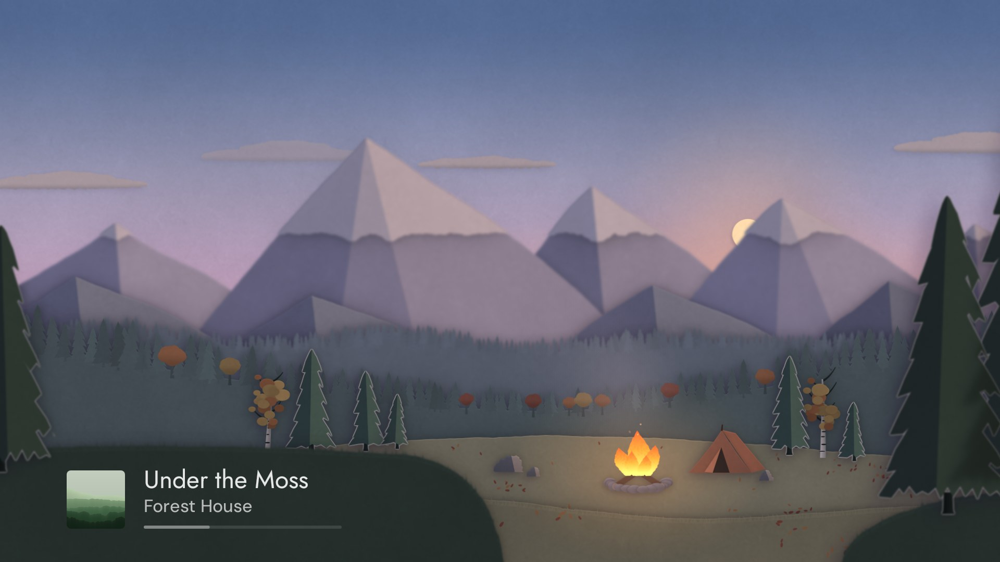

# Klangbild

Klangbild turns your Android TV into a now playing screen. It shows the cover, title and artist of what is playing.

It works with any Home Assistant media player, but it is built for Music Assistant, which adds the queue and the chapters of audiobooks and podcasts.

When the music pauses, a paper landscape appears with the sky as it is outside.

Download the APK from the latest [release](https://github.com/hazymorning/Klangbild/releases/latest).

