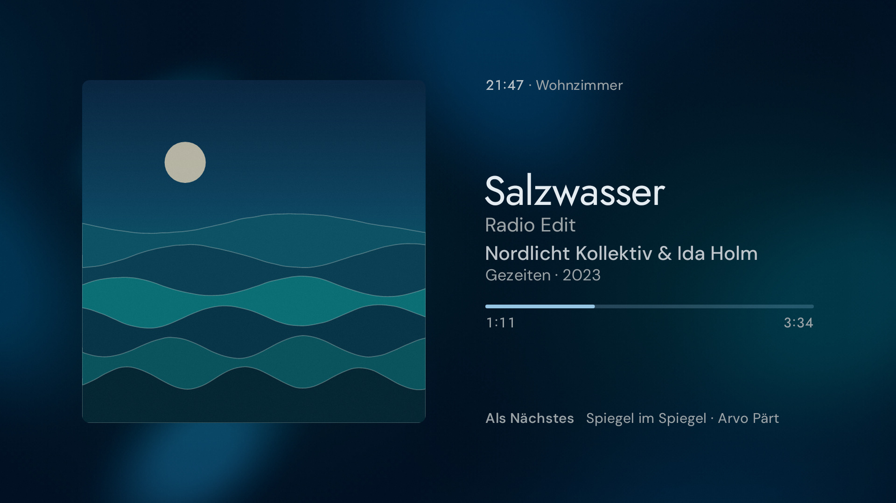
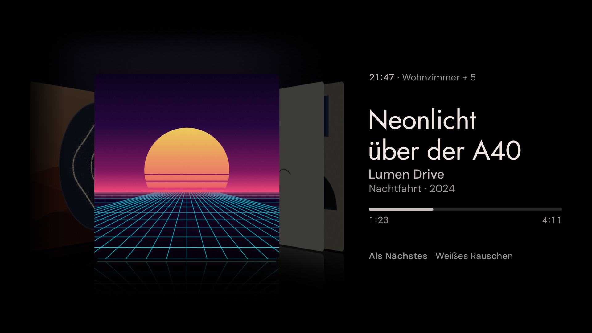

# Klangbild

Klangbild is a now-playing screen for Home Assistant and Music Assistant on Android TV: the cover large, the type set with care.

- Backdrop and Hue lights in the cover's colours
- Cover Flow through the queue
- Fensterblick: a paper diorama in the light and weather outside
- Audiobooks and podcasts with chapters
- Made for OLED, set up from the phone

German interface. APK under [Releases](https://github.com/hazymorning/Klangbild/releases/latest).

