# Klangbild

**Was gerade im Wohnzimmer läuft – als Bild an der Wand.**

Klangbild ist eine Android-TV-App für den Google TV Streamer. Sobald Music Assistant im
Wohnzimmer Musik abspielt, weckt Home Assistant den Fernseher und Klangbild zeigt, was
läuft: das Cover wie ein hinterleuchtetes Kunstwerk, sein Licht fällt in seiner eigenen
Farbe auf eine dunkle Wand, daneben Titel und Künstler in ruhiger Typografie. Keine Knöpfe,
keine Leisten, kein Fortschrittsbalken – die Zeit erzählt eine wandernde Lichtquelle hinter
dem Cover und eine Zeile in Worten: *„In drei Minuten · Spiegel im Spiegel · Arvo Pärt“*.

> *Klangbild* (das): in der Hi-Fi-Sprache der Charakter eines Klangs – und wörtlich das Bild
> des Klangs.

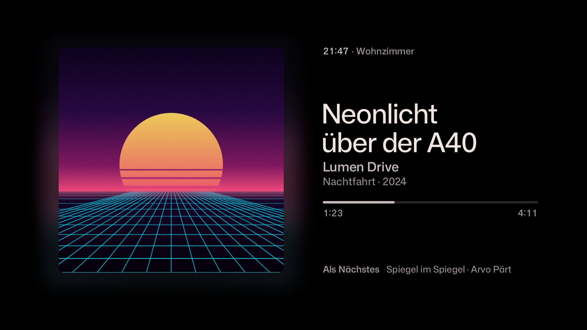

## Inhalt

- [Bilder](#bilder)
- [Was Klangbild kann](#was-klangbild-kann)
- [Installation](#installation)
- [Einrichtung](#einrichtung)
- [Home-Assistant-Automationen](#home-assistant-automationen)
- [Bedienung mit der Fernbedienung](#bedienung-mit-der-fernbedienung)
- [Bildschirmschoner (optional)](#bildschirmschoner-optional)
- [Fehlerbehebung](#fehlerbehebung)
- [Datenschutz und Sicherheit](#datenschutz-und-sicherheit)
- [Entwicklung](#entwicklung)
- [Lizenzen](#lizenzen)
- Ideen und nächste Schritte: [`docs/IDEEN.md`](docs/IDEEN.md)

## Bilder

Alle Bilder stammen aus den Screenshot-Tests der App (gerendert auf der JVM in
1920 × 1080). Die Cover sind prozedural erzeugt – echte Albumcover liegen nicht im Repo.

| | |
|---|---|
|  | 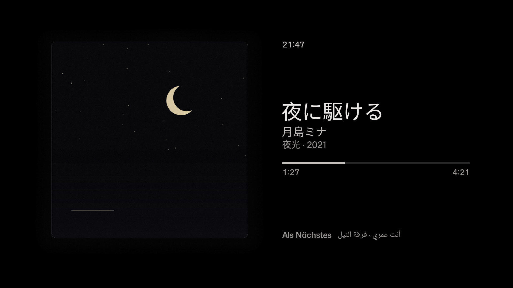 |
| *Klassik: Werk über dem Satz, viele Mitwirkende auf einer Zeile mit „u. a.“* | *Japanisch, fast schwarzes Cover im warmweißen Lampenlicht* |
|  | 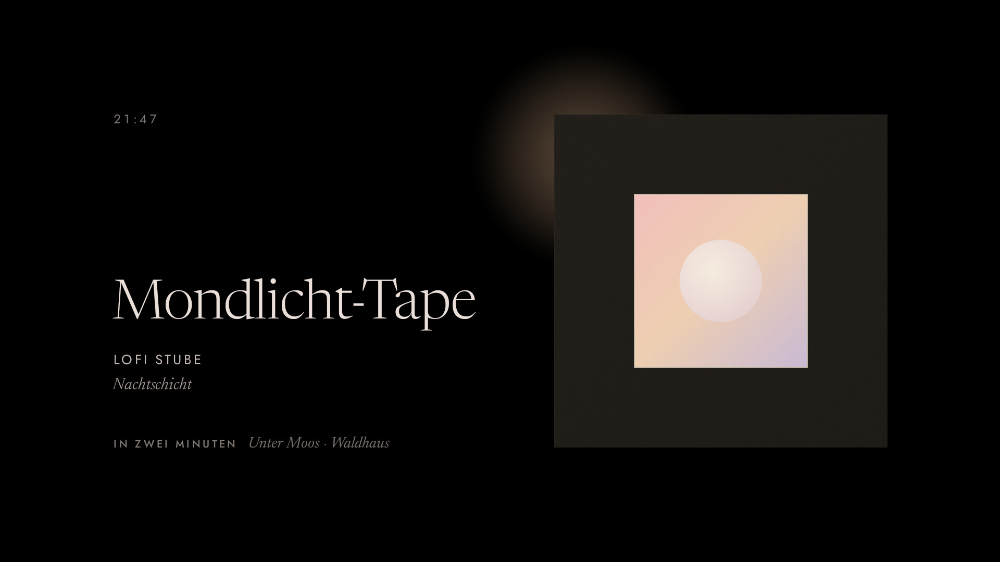 |
| *Radio ohne Cover: Sand auf einer schwingenden Platte, sanft gewellte Knotenkreise (Chladni-Figur) – buchstäblich ein Bild des Klangs* | *Ein 300-px-Cover bleibt klein und scharf, im Passepartout statt groß und matschig* |
| 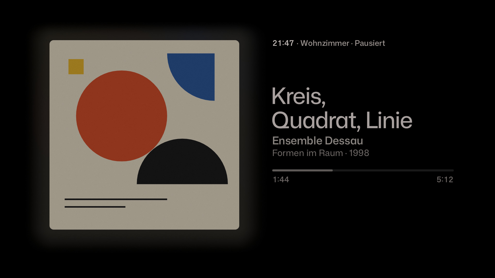 | 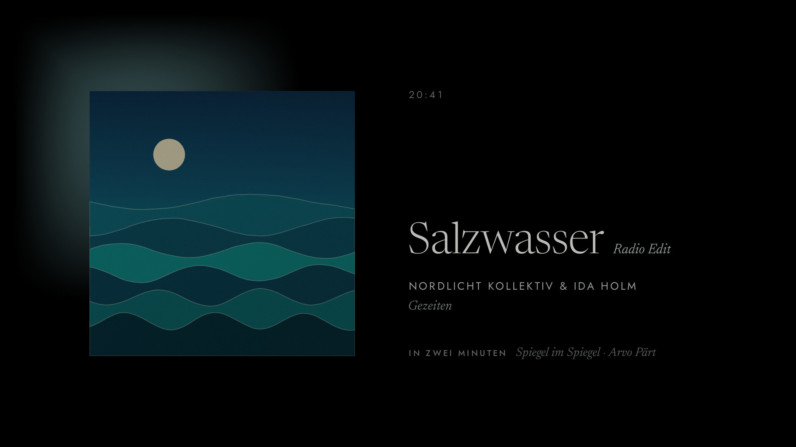 |
| *Pausiert: das Licht wird gedimmt wie eine Lampe* | *Abends wärmer und dunkler* |
| 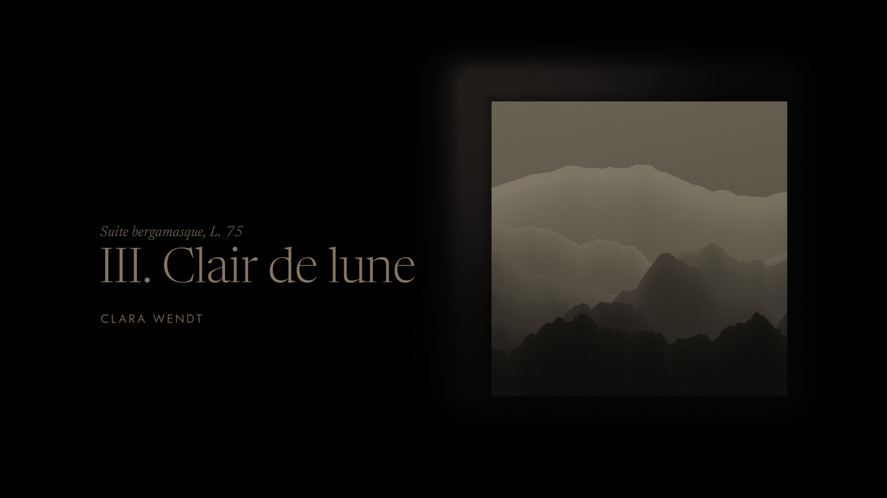 | 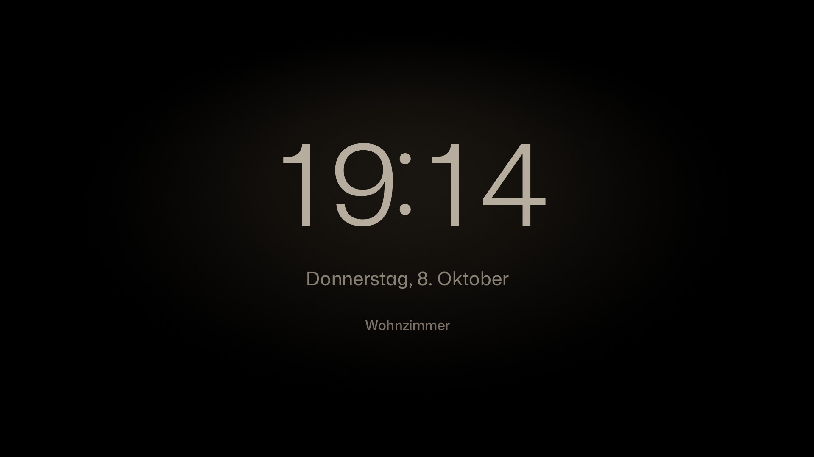 |
| *Nachts sehr zurückhaltend: nur Cover, Titel, Künstler* | *Nichts läuft: eine stille Uhr an einer Wand im Lampenlicht* |
| 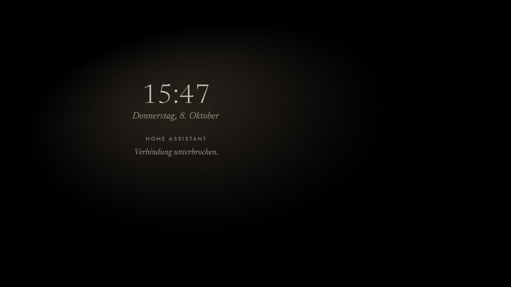 | 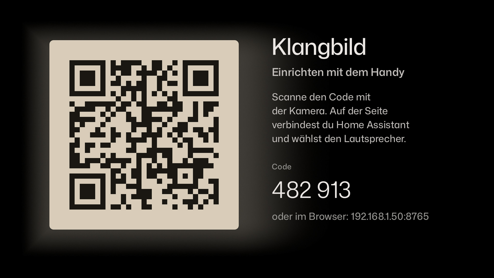 |
| *Verbindung weg: ruhig erklärt, nie ein Fehlercode* | *Einrichtung: der QR-Code hängt wie ein Bild an der Wand* |
| 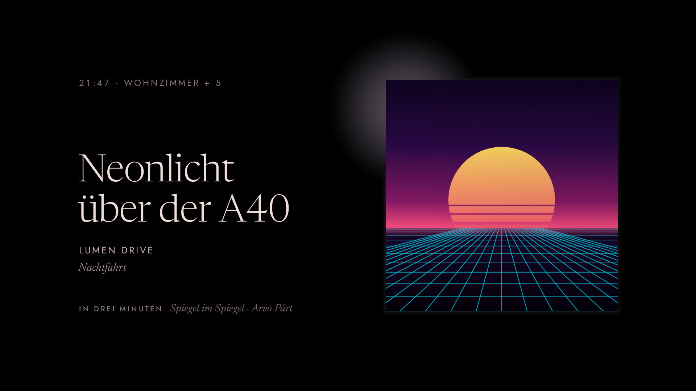 | 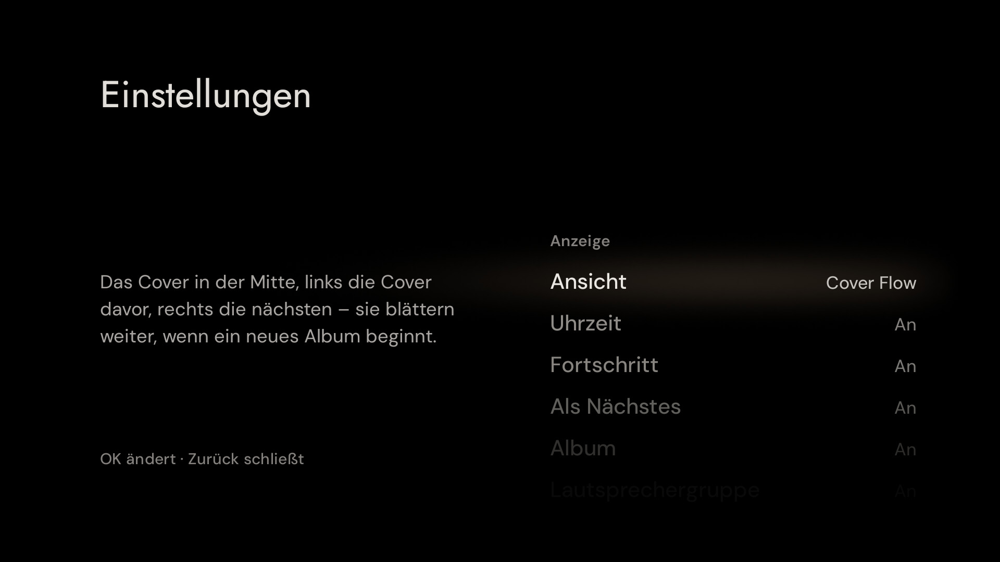 |
| *Fünf weitere Lautsprecher spielen mit: „Wohnzimmer + 5“ neben der Uhrzeit* | *Einstellungen mit der Fernbedienung: die gewählte Zeile steht im Licht einer Lampe* |

**Titelwechsel** – das alte Bild wird dunkel, die Lampe wird heruntergedreht, und wo das
Bild hing, liegt für einen Moment nur ihr schwacher, runder Lichtkegel auf der leeren Wand;
sie wechselt ihre Farbe, dann kommt das neue Bild mit dem Licht, der Text folgt. Uhr und
unveränderte Zeilen bleiben stehen (wechselt das Bild die Seite, wartet die Uhr gedimmt an
ihrem Platz); beim nächsten Titel desselben Albums wechselt nur der Text:


Die drei verworfenen bzw. weiterentwickelten Gestaltungsrichtungen und die Begründung der
Wahl stehen in [`docs/DECISIONS.md`](docs/DECISIONS.md) und
[`docs/design/richtungen.jpg`](docs/design/richtungen.jpg).

## Was Klangbild kann

- **Licht aus dem Bild.** Eine Lampe steht verdeckt hinter dem Cover, nah an seinem Rand,
  und wirft einen runden, weichen Lichtkegel an die Wand – in der Leitfarbe des Covers
  (Farbanalyse im Farbraum Oklab): der violette Himmel eines Synthwave-Covers, nicht seine
  kleine orange Sonne. Warme Cover bekommen Glühlampenlicht (≈ 3300 K) statt rostbraunem
  Schein, graue und weiße Cover warmweißes Licht; kühle Cover behalten tagsüber dezent ihren
  Farbton, abends wird ihr Licht zu Glühlampenlicht. Weiße Cover blenden nie. Am Bildrand ist das Licht am hellsten und läuft nach etwa einem Fünftel
  der Bildbreite weich aus; die abgewandte Seite bleibt dunkel, ein dunkles Cover
  bekommt dort einen feinen Lichtsaum, damit seine Kanten nicht in der Wand verschwinden.
  Weit weg vom Bild und am Bildschirmrand ist die Wand schwarz.
- **Das Licht als Sonnenuhr.** Die Lampe hinter dem Bild wandert im Lauf des Titels von
  links unten über oben nach rechts unten – unmerklich langsam, nach ein paar Minuten
  deutlich; das Licht fällt jeweils auf dieser Seite an die Wand. Bei Radio pendelt sie
  langsam mit der Uhrzeit. Ein feines Streiflicht liegt über dem Cover.
- **Zeit in Worten.** „In drei Minuten · nächster Titel“, „Gleich“, „Letzte Takte“,
  „Pausiert“. Genaue Zeiten erscheinen nur kurz nach einem Tastendruck.
- **Typografie mit Haltung.** Newsreader für Titel, Jost für Kapitälchen und Ziffern.
  Klassische Titel werden in Werk und Satz geteilt und brechen bevorzugt nach den
  Gedankenstrichen um (höchstens drei Zeilen), „(feat. …)“ wandert zu den Künstlern,
  „– 2011 Remaster“ wird zur kleinen Notiz hinter dem Titel, „Nr. 9“ und „op. 125“ trennen
  nie. Künstler stehen auf einer Zeile („… u. a.“). Japanisch, Arabisch (rechts nach links)
  und Emoji werden korrekt gesetzt – ohne Versalien, Sperrung oder falsche Kursive; Emoji
  am Rand eines Titels fallen weg, Emoji im Titel werden gedämpft.
- **Ehrlich mit der Auflösung.** Klangbild holt sich die größte verfügbare Coverversion
  (Music Assistant, Spotify, Deezer, Apple Music, Tidal, Qobuz, YouTube Music) und zeigt sie
  nie größer, als sie es verträgt; ein kleines Bild bekommt ein dunkles Passepartout mit
  heller Schnittkante.
- **Tageszeit.** Mit `sun.sun` aus Home Assistant: abends dunkler und wärmer, nachts nur
  noch Cover, Titel und Künstler. Ohne Home Assistant (Demo) nach der Uhrzeit.
- **OLED-Schutz.** Die ganze Komposition wandert langsam um ein paar Pixel, das Layout
  spiegelt sich je Album, das Licht bewegt sich, die Uhr im Ruhebildschirm wird jede
  Viertelstunde umgehängt, nichts steht stundenlang still. Am Bildrand ist es immer schwarz.
- **Jeder Zustand ist gestaltet:** spielt, pausiert, puffert, Titelwechsel, nichts läuft,
  Verbindung weg, Lautsprecher nicht erreichbar oder unbekannt, Token abgelehnt, Einrichtung.
- **Als Nächstes** kommt aus der Music-Assistant-Warteschlange (`music_assistant.get_queue`);
  das Cover des nächsten Titels wird vorab berechnet, damit der Wechsel nahtlos ist.
- **Lautsprechergruppe.** Spielen weitere Lautsprecher mit (Music Assistant, Attribut
  `group_members`), steht neben der Uhrzeit „Wohnzimmer + 5“ – so, wie Sonos und Spotify
  Gruppen benennen; bei nur einem weiteren Lautsprecher beide Namen („Wohnzimmer + Küche“).
  Spielt er in einem Gruppen-Player von Music Assistant mit, steht dessen Name da
  („Erdgeschoss“). Gerätewörter wie „Lautsprecher“ oder „Sonos One“ fallen aus dem Namen
  weg. Spielt der Lautsprecher allein, steht dort nichts.
- **Lautstärke.** Ändert sie sich – am Handy, in Home Assistant, egal wo –, steht sie ein paar
  Sekunden unter dem Bild („Lautstärke 35 %“); auf Wunsch ständig neben der Uhrzeit oder nie.
- **Einstellungen mit der Fernbedienung.** Jede Zeile lässt sich einzeln zeigen oder
  verbergen, die Lampe kräftiger, dezenter oder ganz ausschalten (siehe
  [Bedienung](#bedienung-mit-der-fernbedienung)).
- **Ruhe.** Der Bildschirm bleibt nur an, solange Musik läuft. Nach einer einstellbaren
  Zeit ohne Musik gibt Klangbild den Bildschirm frei oder schließt sich.
- **Demo-Modus** ohne Home Assistant: zwölf erfundene Veröffentlichungen mit erzeugten
  Covern, die alle Grenzfälle zeigen.

## Installation

Voraussetzung: ADB-Zugriff auf den Google TV Streamer (den hast du für die
Home-Assistant-Integration ohnehin).

1. **APK holen.** Die signierte Release-APK hängt am [neuesten Release](../../releases/latest)
   – auf der Startseite des Repositorys rechts unter *Releases* („Latest“). Fester Link:
   `https://github.com/hazymorning/Music-Assistant-TV/releases/latest/download/klangbild.apk`
   (das Repository ist privat, also im Browser angemeldet herunterladen). Ein Release entsteht
   durch ein Tag wie `v1.1.0` oder einen manuellen CI-Lauf mit `release_tag`, außerdem bei
   jedem Build auf `main`; ein Tag mit Bindestrich (`v1.2.0-beta.1`) wird eine Vorabversion.
   Für jeden Branch gibt es die APK außerdem als Artifact `klangbild-apk` im jeweiligen
   [Actions-Lauf](../../actions).
2. **Installieren** (vom Rechner im selben Netz):
   ```bash
   adb connect 192.168.1.50:5555          # IP des Streamers
   adb install -r klangbild.apk           # -r: Update ohne Deinstallation
   ```
   Updates funktionieren immer mit `adb install -r`, weil jede Version mit demselben
   Schlüssel signiert ist und der `versionCode` automatisch steigt.
3. **Starten:** Google TV zeigt per ADB installierte Apps nicht in der Startzeile, aber in
   der Übersicht: *Apps → Ihre Apps → Alle anzeigen* (ganz ans Ende der Zeile scrollen).
   Dort Klangbild mit *OK* lang drücken → *Verschieben* bzw. *Zu Favoriten hinzufügen*, dann
   steht es in der Zeile „Ihre Apps“ auf dem Startbildschirm. Die Stern-Taste der
   Streamer-Fernbedienung lässt sich unter *Einstellungen → Fernbedienungen und Zubehör* mit
   einer App belegen. (Beides nicht am echten Gerät mit Klangbild geprüft – die Menünamen
   können je nach Google-TV-Version abweichen.) Aus Home Assistant siehe
   [Klangbild öffnen](#klangbild-aus-home-assistant-öffnen). Oder per ADB:
   ```bash
   adb shell am start -n io.github.hazymorning.klangbild/.MainActivity
   ```

Direkt ausprobieren ohne Home Assistant:

```bash
adb shell am start -n io.github.hazymorning.klangbild/.MainActivity --ez demo true
```

## Einrichtung

Beim ersten Start zeigt Klangbild einen QR-Code und einen sechsstelligen Code.

1. QR-Code mit der Handykamera scannen. Es öffnet sich eine kleine Seite, die der
   Fernseher selbst im Heimnetz bereitstellt (z. B. `http://192.168.1.50:8765`).
2. **Home-Assistant-Adresse** eintragen, z. B. `http://192.168.1.10:8123` oder die
   Nabu-Casa-Adresse `https://….ui.nabu.casa`.
3. **Langlebiges Zugangstoken** einfügen. In Home Assistant: *Profil → Sicherheit →
   Langlebige Zugangstoken → Token erstellen*.
4. *Lautsprecher suchen* – Klangbild fragt Home Assistant nach allen `media_player`-Entitäten,
   Music-Assistant-Player stehen oben. Den Wohnzimmer-Lautsprecher wählen.
5. Ruhezeit und Optionen wählen, *Speichern*. Der Fernseher verbindet sich sofort.

Später ändert sich die Verbindung über die Einstellungen am Fernseher: **OK lange drücken**
(oder die Menütaste) → *Verbindung → Home Assistant* zeigt den QR-Code wieder. *Zurück*
schließt ihn.

### Alternativ: alles per ADB

```bash
adb shell am start -n io.github.hazymorning.klangbild/.MainActivity \
    --es ha_url "http://192.168.1.10:8123" \
    --es token "eyJ0eXAiOiJKV1Qi…" \
    --es entity media_player.wohnzimmer
```

| Extra | Typ | Wirkung |
|---|---|---|
| `ha_url` | String | Adresse von Home Assistant (wird gespeichert) |
| `token` | String | Langlebiges Zugangstoken (wird gespeichert) |
| `entity` | String | `media_player`-Entität (wird gespeichert) |
| `sleep_minutes` | Int/String | Minuten ohne Musik bis zur Ruhe (1–720, Standard 10) |
| `sleep_action` | String | `release` (Bildschirm freigeben, Standard) oder `close` (App schließen) |
| `clock` | Boolean | Uhr anzeigen (Standard `true`) |
| `time_line` | Boolean | Restzeit unter dem Bild (Standard `true`) |
| `next` | Boolean | „Als Nächstes“ in der Restzeit (Standard `true`) |
| `album` | Boolean | Albumtitel (Standard `true`) |
| `group` | Boolean | Lautsprechergruppe neben der Uhr (Standard `true`) |
| `volume` | String | Lautstärke: `bei_aenderung` (Standard), `immer` oder `aus` |
| `light` | String | Lampe: `kraeftig`, `normal` (Standard), `dezent` oder `aus` |
| `day_night` | Boolean | Abends wärmer, nachts nur Bild und Titel (Standard `true`) |
| `remote` | Boolean | Fernbedienung steuert die Musik (Standard `true`) |
| `volume_keys` | Boolean | Pfeil hoch/runter ändern die Lautstärke (Standard `false`) |
| `demo` | Boolean | Nur für diesen Start: Demo statt Home Assistant |
| `setup` | Boolean | Nur für diesen Start: Einstellungen öffnen |
| `debug` | Boolean | Nur für diesen Start: Bildrate einblenden (siehe Fehlerbehebung) |

Läuft Klangbild schon, übernimmt es neue Extras ohne Neustart. Boolesche Werte verstehen
auch `ja`/`nein` und `an`/`aus`.

## Home-Assistant-Automationen

### Klangbild aus Home Assistant öffnen

Wie jede andere App über die Quelle des Streamers – der Paketname ist
`io.github.hazymorning.klangbild`:

```yaml
action: media_player.select_source
target:
  entity_id: media_player.android_tv_wohnzimmer
data:
  source: io.github.hazymorning.klangbild
```

Ohne ADB, mit der Integration *Android TV Remote*, öffnet ein Link die App – auf Wunsch gleich
mit Anzeige-Optionen (nicht am echten Gerät geprüft):

```yaml
action: remote.turn_on
target:
  entity_id: remote.wohnzimmer_tv
data:
  activity: klangbild://open?light=dezent&album=aus
```

Ein Link darf nur Anzeige-Optionen, Ruhezeit und `demo` setzen (dieselben Namen wie die
ADB-Extras unten), nie Adresse, Token oder Lautsprecher – jede Webseite im Browser des
Fernsehers könnte ihn öffnen.

Mit der ADB-Integration (*Android Debug Bridge*) geht es auch mit allen Extras, etwa um den
Lautsprecher mitzugeben oder für den Abend die Lampe zu dämpfen:

```yaml
action: androidtv.adb_command
target:
  entity_id: media_player.android_tv_wohnzimmer
data:
  command: >-
    am start -n io.github.hazymorning.klangbild/.MainActivity
    --es entity media_player.wohnzimmer --es light dezent
```

Als Button im Dashboard (Tap-Aktion):

```yaml
type: button
name: Klangbild
icon: mdi:image-frame
tap_action:
  action: perform-action
  perform_action: media_player.select_source
  target:
    entity_id: media_player.android_tv_wohnzimmer
  data:
    source: io.github.hazymorning.klangbild
```

Platzhalter anpassen:
- `media_player.wohnzimmer` – der Music-Assistant-Player im Wohnzimmer
- `media_player.google_tv_streamer` – die Entität der *Android TV*-Integration (ADB) des Streamers

### Start: Musik läuft → Fernseher wecken, Klangbild öffnen

Startet nur, wenn auf dem Streamer gerade nichts anderes läuft (also z. B. nicht während
Netflix): erlaubt sind ausgeschaltet/Standby, der Google-TV-Startbildschirm, der
Bildschirmschoner und Klangbild selbst.

```yaml
alias: Klangbild – Musik im Wohnzimmer zeigen
description: Weckt den Google TV Streamer und öffnet Klangbild, sobald im Wohnzimmer Musik läuft.
mode: single
triggers:
  - trigger: state
    entity_id: media_player.wohnzimmer
    to: playing
conditions:
  - condition: template
    value_template: >
      
      
      {{ states(tv) in ['off', 'standby', 'unavailable']
         or app in [none,
                    'com.google.android.apps.tv.launcherx',
                    'com.google.android.tvlauncher',
                    'com.google.android.apps.tv.dreamx',
                    'io.github.hazymorning.klangbild'] }}
actions:
  - action: androidtv.adb_command
    target:
      entity_id: media_player.google_tv_streamer
    data:
      command: input keyevent KEYCODE_WAKEUP
  - delay: "00:00:02"
  - action: androidtv.adb_command
    target:
      entity_id: media_player.google_tv_streamer
    data:
      command: >-
        am start -n io.github.hazymorning.klangbild/.MainActivity
        --es entity media_player.wohnzimmer
```

Hinweise:
- `KEYCODE_WAKEUP` weckt den Streamer; ob er den Fernseher per HDMI-CEC mitweckt, hängt von
  den CEC-Einstellungen von Streamer und Fernseher ab (am echten Gerät prüfen).
- Den aktuellen Paketnamen des Startbildschirms siehst du in Home Assistant am Attribut
  `app_id` der Streamer-Entität, wenn der Startbildschirm offen ist.

### Optional: nach längerer Pause zum Startbildschirm oder schlafen

Klangbild gibt den Bildschirm nach der eingestellten Ruhezeit ohnehin frei. Wer den
Streamer aktiv zurückschicken oder schlafen legen will:

```yaml
alias: Klangbild – nach Pause Ruhe
mode: restart
triggers:
  - trigger: state
    entity_id: media_player.wohnzimmer
    from: playing
    for: "00:20:00"
conditions:
  - condition: template
    value_template: >
      {{ state_attr('media_player.google_tv_streamer', 'app_id') == 'io.github.hazymorning.klangbild'
         and not is_state('media_player.wohnzimmer', 'playing') }}
actions:
  - action: androidtv.adb_command
    target:
      entity_id: media_player.google_tv_streamer
    data:
      # HOME = zurück zum Startbildschirm; für Schlafen stattdessen:
      # command: input keyevent KEYCODE_SLEEP
      command: HOME
```

## Bedienung mit der Fernbedienung

Klangbild hat keine sichtbaren Bedienelemente. Die Fernbedienung wirkt trotzdem:

| Taste | Wirkung |
|---|---|
| OK | Pause / Weiter (der Lautsprecher in Home Assistant) |
| ◀ / ▶ | Vorheriger / nächster Titel |
| ▲ / ▼ | Zeigt für ein paar Sekunden die genaue Zeit – oder ändert die Lautstärke (einstellbar) |
| OK lange drücken, Menü | Einstellungen |
| Zurück | Klangbild schließen (bzw. Einstellungen schließen) |

Beim ersten Start ohne Einrichtung startet OK die Demo.

### Einstellungen

*OK lange drücken* (oder die Menütaste) öffnet die Einstellungen. ▲ / ▼ wählen eine Zeile –
sie steht immer in der Mitte, im Licht einer Lampe –, ◀ / ▶ oder OK ändern sie. Jede
Änderung gilt sofort, es gibt nichts zu bestätigen; *Zurück* schließt. Unbenutzt schließen
sich die Einstellungen nach einer Minute von selbst.

| Bereich | Zeile | Werte |
|---|---|---|
| Anzeige | Uhrzeit, Restzeit, Als Nächstes, Album, Lautsprechergruppe | an / aus |
| | Lautstärke | bei Änderung / immer / aus |
| Licht | Lampe | kräftig / normal / dezent / aus |
| | Tag und Nacht | an / aus |
| Fernbedienung | Musik steuern (OK, ◀ / ▶) | an / aus |
| | Hoch und runter | genaue Zeit / Lautstärke |
| Ruhe | Ruhe nach | fünf Minuten bis zwei Stunden |
| | Danach | Bildschirm freigeben / App schließen |
| Verbindung | Home Assistant | OK zeigt den QR-Code zum Einrichten |
| | Demo | OK startet bzw. beendet die Demo |

## Bildschirmschoner (optional)

Klangbild kann auch der System-Bildschirmschoner sein: Läuft Musik, zeigt er sie, sonst die
stille Uhr. Auf Google TV lässt sich ein fremder Bildschirmschoner nur per ADB setzen:

```bash
adb shell settings put secure screensaver_components io.github.hazymorning.klangbild/.dream.KlangbildDream
adb shell settings put secure screensaver_enabled 1
```

Zurück zum Google-Bildschirmschoner (Ambient Mode):

```bash
adb shell settings put secure screensaver_components com.google.android.apps.tv.dreamx/.service.Backdrop
```

Nicht am echten Gerät geprüft: Google TV kann den Wert bei System-Updates oder einem
Zurücksetzen überschreiben; dann die Befehle erneut ausführen.

## Fehlerbehebung

| Was du siehst | Ursache und Abhilfe |
|---|---|
| QR-Code, „Einrichten mit dem Handy“ | Noch nicht eingerichtet. QR-Code scannen oder per ADB-Extras einrichten. |
| „Home Assistant hat das Zugangstoken abgelehnt.“ | Token gelöscht oder falsch kopiert. Neues langlebiges Zugangstoken erstellen und über den QR-Code eintragen. |
| „Verbindung wird hergestellt …“ bleibt stehen | Adresse prüfen (mit `http://` und Port `:8123`). Hostnamen wie `homeassistant.local` löst nicht jedes Gerät auf – im Zweifel die IP-Adresse nehmen. |
| „Verbindung unterbrochen.“ | WLAN weg oder Home Assistant startet neu. Klangbild versucht es von selbst wieder (mit wachsendem Abstand, höchstens jede Minute) und sofort, sobald das Netz zurück ist. In den ersten zwei Minuten bleibt das Bild stehen und wird nur gedimmt. |
| „Home Assistant kennt „media_player.…“ nicht.“ | Entität falsch geschrieben oder umbenannt. In den Einstellungen neu wählen. |
| „Gerade nicht erreichbar.“ | Der Lautsprecher meldet `unavailable` (z. B. Music Assistant läuft nicht). |
| Kein „In … Minuten · nächster Titel“ | Der nächste Titel kommt aus Music Assistant. Bei anderen Playern oder Radio zeigt Klangbild nur die Restzeit bzw. den Sender. |
| Unverschlüsseltes `http://` wird abgelehnt | Klartext ist nur im Heimnetz erlaubt (private Adressen, `.local`, `.lan`, Namen ohne Punkt). Von außen bitte `https://` (z. B. Nabu Casa). |
| Die Einrichtungsseite lädt nicht | Handy und Fernseher müssen im selben Netz sein; die Seite läuft nur, solange der QR-Code zu sehen ist. |
| Ruckeln? | Mit `--ez debug true` starten: oben links stehen Bilder pro Sekunde, langsamster Frame und verspätete Frames. Außerdem: `adb shell dumpsys gfxinfo io.github.hazymorning.klangbild`. |
| App schließt nach einer Weile | Ruhezeit mit „App schließen“ eingestellt – in den Einstellungen auf „Bildschirm freigeben“ ändern. |
| Klangbild fehlt auf dem Startbildschirm | Per ADB installierte Apps stehen unter *Apps → Ihre Apps → Alle anzeigen*; von dort zu den Favoriten verschieben. Oder aus Home Assistant öffnen (`media_player.select_source`). |
| Keine Lautsprechergruppe zu sehen | Music Assistant meldet synchron gruppierte Lautsprecher über das Attribut `group_members`; spielt der Lautsprecher in einem Gruppen-Player mit, erkennt Klangbild das am Namen der aktiven Warteschlange (`music_assistant.get_queue`), spätestens nach einer Minute. Spielt der Lautsprecher allein, steht bewusst nichts da. |

Logs: `adb logcat | grep -i klangbild`

## Datenschutz und Sicherheit

- Keine Telemetrie, keine Werbung, keine Cloud-Dienste. Klangbild spricht nur mit deinem
  Home Assistant, deinem Music-Assistant-Server und den Cover-Servern der Musikdienste.
- Der Token liegt nur im App-eigenen Speicher; Backups und Geräteübertragung sind
  ausgeschlossen. Er wird ausschließlich an den Home-Assistant-Host geschickt, nie an
  Cover-Server.
- Die Einrichtungsseite läuft nur, solange der QR-Code zu sehen ist, verlangt den
  sechsstelligen Code (nach acht Fehlversuchen gibt es einen neuen) und gibt den
  gespeicherten Token nie zurück. Im Heimnetz läuft sie über `http://` – wie meist auch
  Home Assistant selbst.
- Der Signaturschlüssel im Repo (`keystore/`) ist nur für diese App erzeugt und schützt
  nichts außer Updates dieser privaten Sideload-App (siehe `docs/DECISIONS.md`).

## Entwicklung

```bash
./gradlew :app:testDebugUnitTest                                # Unit- und Screenshot-Tests
./gradlew :app:testDebugUnitTest -Proborazzi.test.record=true   # Screenshots nach app/build/screenshots/
./gradlew :app:assembleRelease                                  # signierte Release-APK (R8)
```

- Architektur, Design-Prinzipien und Build-Hinweise: [`CLAUDE.md`](CLAUDE.md)
- Plan und Entscheidungen: [`docs/PLAN.md`](docs/PLAN.md), [`docs/DECISIONS.md`](docs/DECISIONS.md)
- CI (GitHub Actions): Tests, Screenshots als Artifact, signierte APK als Artifact,
  Smoke-Test der Release-APK auf einem Android-TV-14-Emulator im Demo-Modus (mit Screenshots
  als Artifact), auf `main` zusätzlich ein Release, für Tags `v*` eine Beta (Pre-Release).

## Lizenzen

- Schriften: [Newsreader](app/src/main/assets/licenses/Newsreader-OFL.txt) (Production Type)
  und [Jost](app/src/main/assets/licenses/Jost-OFL.txt) (indestructible type*), beide unter
  der SIL Open Font License 1.1, in die App eingebunden.
- Bibliotheken: AndroidX/Jetpack Compose, Kotlin Coroutines und kotlinx.serialization,
  OkHttp, ZXing – Apache License 2.0.
