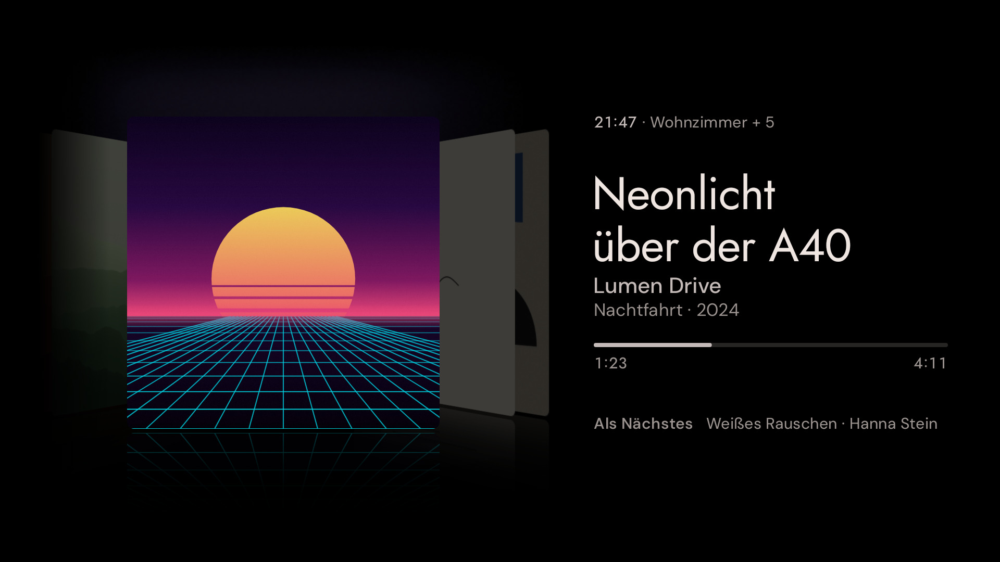
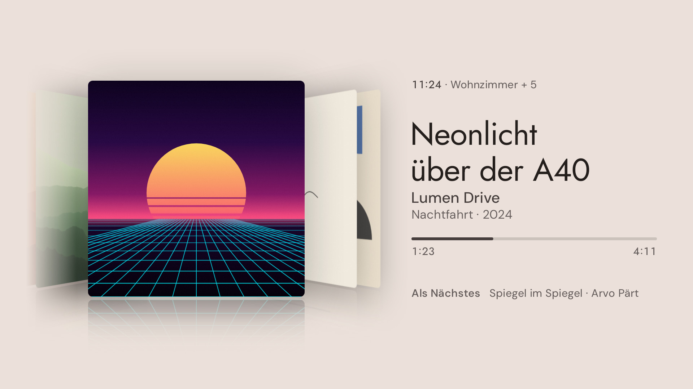
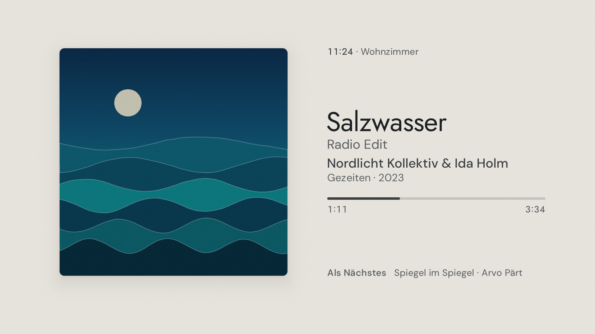
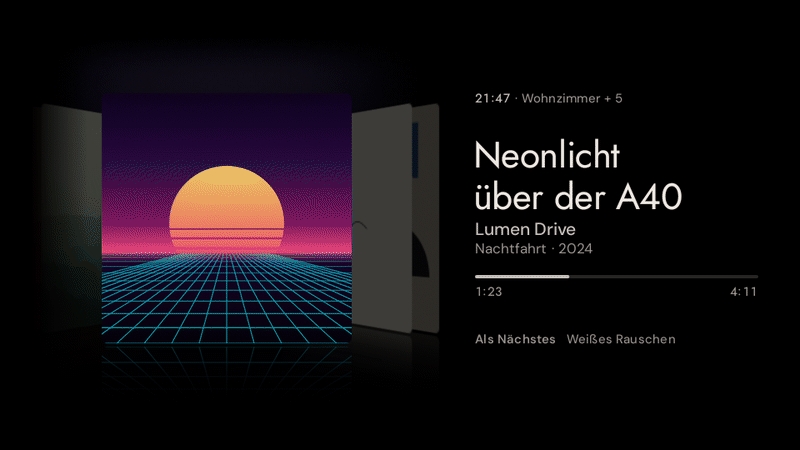

# Klangbild

**Was gerade im Wohnzimmer läuft – als Bild an der Wand.**

Klangbild ist eine Android-TV-App für den Google TV Streamer. Sobald Music Assistant im
Wohnzimmer Musik abspielt, weckt Home Assistant den Fernseher und Klangbild zeigt, was
läuft: das Cover groß wie ein Bild an der Wand, sein Licht fällt in den Farben seiner Ränder
auf die dunkle Wand, daneben Titel, Künstler und Album in klarer Typografie und ein
schlichter Fortschrittsbalken – oder, als zweite Ansicht, alle Cover in einer Reihe wie im
Cover Flow. Tagsüber hängt das Bild an einer hellen Papierwand, abends an einer dunklen.
Keine Knöpfe, keine Symbole, nichts, was blinkt.

> *Klangbild* (das): in der Hi-Fi-Sprache der Charakter eines Klangs – und wörtlich das Bild
> des Klangs.


## Inhalt

- [Bilder](#bilder)
- [Was Klangbild kann](#was-klangbild-kann)
- [Installation](#installation)
- [Einrichtung](#einrichtung)
- [Home-Assistant-Automationen](#home-assistant-automationen)
- [Bedienung mit der Fernbedienung](#bedienung-mit-der-fernbedienung)
- [Bildschirmschoner (optional)](#bildschirmschoner-optional)
- [Fehlerbehebung](#fehlerbehebung)
- [Datenschutz und Sicherheit](#datenschutz-und-sicherheit)
- [Entwicklung](#entwicklung)
- [Lizenzen](#lizenzen)
- Ideen und nächste Schritte: [`docs/IDEEN.md`](docs/IDEEN.md)

## Bilder

Alle Bilder stammen aus den Screenshot-Tests der App (gerendert auf der JVM in
1920 × 1080). Die Cover sind prozedural erzeugt – echte Albumcover liegen nicht im Repo.

| | |
|---|---|
|  |  |
| *Klassik: Werk über dem Satz, viele Mitwirkende auf einer Zeile mit „u. a.“* | *Japanisch, fast schwarzes Cover mit feiner Lichtkante* |
|  |  |
| *Radio ohne Cover: Sand auf einer schwingenden Platte, sanft gewellte Knotenkreise (Chladni-Figur) – buchstäblich ein Bild des Klangs* | *Ein 300-px-Cover bleibt klein und scharf, im Passepartout statt groß und matschig* |
|  |  |
| *Pausiert: Licht, Bild und Text werden gedimmt* | *Abends wärmer und dunkler* |
|  |  |
| *Nachts gedämpft und wärmer – alles bleibt zu sehen* | *Nichts läuft: eine stille Uhr an einer kaum beleuchteten Wand* |
|  |  |
| *Verbindung weg: ruhig erklärt, nie ein Fehlercode* | *Einrichtung: der QR-Code hängt wie ein Bild an der Wand* |
|  |  |
| *Fünf weitere Lautsprecher spielen mit: „Wohnzimmer + 5“ neben der Uhrzeit* | *Einstellungen mit der Fernbedienung: die gewählte Zeile steht im Licht* |
|  |  |
| *Cover Flow: links was lief, rechts was kommt, darüber ein Schein in der Farbe des Covers* | *Cover Flow am Tag: Papier statt Schwarz, weiche Schatten statt Licht und Spiegelung* |
|  | |
| *Am Tag: warmes Papier mit einem Hauch der Coverfarbe, das Bild wirft einen Schatten* | |

**Titelwechsel** – in gut einer Sekunde: das alte Cover verlischt, das neue kommt aus dem
Dunkel und setzt sich aus einer Spur Größe an seinen Platz, das Licht wechselt in die neuen
Farben, die alten Zeilen gehen, die neuen steigen eine nach der anderen an ihren Platz – nie
zwei Bilder übereinander. Beim nächsten Titel desselben Albums wechselt nur der Text:


**Cover Flow** – in 1,3 Sekunden dreht sich die Reihe weiter: Das alte Cover schwenkt zur
Seite, das nächste wendet sich dem Raum zu, ohne dass sich zwei Bilder je durchdringen; neue
Cover rollen vom Ende der Reihe herein:



Die drei verworfenen bzw. weiterentwickelten Gestaltungsrichtungen und die Begründung der
Wahl stehen in [`docs/DECISIONS.md`](docs/DECISIONS.md) und
[`docs/design/richtungen.jpg`](docs/design/richtungen.jpg).

## Was Klangbild kann

- **Zwei Ansichten.** *Einzelbild*: ein Cover an der Wand, in seinem eigenen Licht.
  *Cover Flow*: das Cover in der Mitte, links die Alben davor, rechts die nächsten, gedreht im
  Raum und im Dunkeln auf glänzendem Boden gespiegelt, darüber ein Schein in der Farbe seiner
  Oberkante; die Lieder eines Albums sind ein Cover, ein Radiosender auch. Kommt ein neues Album, dreht sich die Reihe weiter; schaltet jemand
  schnell weiter, endet jede Bewegung sauber, bevor die nächste beginnt. Mit Music Assistant
  direkt verbunden (freiwillig, siehe [Einrichtung](#einrichtung)) zeigt die Reihe die ganze
  Warteschlange: zwei Cover rechts, die echte Vorgeschichte links.
- **Hell am Tag, dunkel am Abend.** Automatisch nach der Sonne (`sun.sun`, sonst nach der
  Uhr), in den Einstellungen auch fest hell oder dunkel. Die helle Wand ist warmes Papier mit
  einem Hauch der Coverfarbe, das Bild wirft einen weichen Schatten; der Wechsel geht langsam,
  wie das Licht draußen.
- **Das Bild ist die Hauptsache.** Das Cover nimmt zwei Drittel der Bildschirmhöhe ein und
  ist immer das größte und schwerste Element; der Textblock daneben ist deutlich kleiner und
  steht optisch mittig neben ihm (gemessen von der Versalhöhe der ersten bis zur Grundlinie
  der letzten Zeile). Die Uhrzeit hängt an der Oberkante des Covers, „Als Nächstes“ steht auf
  seiner Unterkante – alles auf einer linken Kante. Die ganze Gruppe sitzt eine Spur über der
  Bildschirmmitte, wie ein gut gehängtes Bild.
- **Licht aus dem Bild.** Das Cover leuchtet als enger, weicher Hof in den Farben seiner
  Ränder auf die schwarze Wand – warmes Papierlicht um ein helles Cover, Rosa unter einem
  Synthwave-Horizont, Türkis neben dem Meer –, auf allen Seiten gleich. Je weiter weg, desto
  mehr mischen sich die Farben, wie bei echtem, weichem Licht. Ein Bild wirft höchstens so
  viel Licht, wie es hell ist: Ein dunkles Cover leuchtet kaum. Der Text steht auf Schwarz,
  der Bildschirmrand bleibt immer schwarz, weiße Cover blenden nie.
- **Fortschritt, wie man ihn kennt.** Ein schmaler Balken mit gespielter Zeit links und der
  Länge des Titels rechts („1:23 … 4:11“) – es tickt nur eine Zahl, und ihre Ziffern stehen in
  festen Zellen, nichts zittert. Er gleitet: Er wird etwa 30-mal pro Sekunde im Takt des
  Bildschirms neu gezeichnet und wächst jedes Mal um Bruchteile eines Pixels, ein Sprung
  (Spulen) gleitet in einer Drittelsekunde an die neue Stelle. Pausiert wird er etwas
  dunkler. (Die Bildrate auf dem Streamer ist noch nicht am Gerät gemessen.)
- **Typografie.** Zwei Schriften, die sich ergänzen: Titel, Uhr und Zahlen in Jost, einer
  geometrischen Grotesk in der Linie der Futura; alle kleineren Zeilen in DM Sans, die mit
  optischen Größen für kleine Schrift gebaut ist. Rangfolge allein über Größe, Gewicht und
  Helligkeit – keine Versalien, keine Sperrung, keine Kursive.
  Klassische Titel werden in Werk und Satz geteilt und brechen bevorzugt nach den
  Gedankenstrichen um (höchstens drei Zeilen), „(feat. …)“ wandert zu den Künstlern,
  „– 2011 Remaster“ wird zur leisen Notiz hinter dem Titel, „Nr. 9“ und „op. 125“ trennen
  nie, ein kurzes Wort bleibt beim nächsten („Spiegel / im Spiegel“). Künstler stehen auf
  einer Zeile (erst etwas kleiner, dann „… u. a.“), passt das Jahr nicht mehr hinter das
  Album, fällt es weg; sehr lange Titel werden kleiner, bis zu vier Zeilen. Uhrzeit und
  Zeiten stehen in festen Ziffernzellen, der Doppelpunkt mittig. Japanisch, Arabisch
  (rechts nach links) und Emoji werden korrekt gesetzt; Emoji am Rand eines Titels fallen
  weg, Emoji im Titel werden gedämpft.
- **Ehrlich mit der Auflösung.** Klangbild holt sich die größte verfügbare Coverversion
  (Music Assistant, Spotify, Deezer, Apple Music, Tidal, Qobuz, YouTube Music) und zeigt sie
  nie größer, als sie es verträgt; ein kleines Bild bekommt ein dunkles Passepartout mit
  heller Schnittkante.
- **Tageszeit.** Mit `sun.sun` aus Home Assistant: abends wärmer, nachts gedämpfter – Licht,
  Cover und Schrift. Ausgeblendet wird dabei nichts; jede Zeile bleibt gut lesbar.
- **OLED-Schutz.** Die ganze Komposition wandert unmerklich um ein paar Pixel, die Uhr im
  Ruhebildschirm wird jede Viertelstunde umgehängt, am Bildschirmrand ist es immer schwarz.
- **Jeder Zustand ist gestaltet:** spielt, pausiert, puffert, stumm, Titelwechsel, nichts läuft, Verbindung weg, Lautsprecher nicht erreichbar
  oder unbekannt, Token abgelehnt, Einrichtung.
- **Als Nächstes** kommt aus der Music-Assistant-Warteschlange (`music_assistant.get_queue`);
  das Cover des nächsten Titels wird vorab berechnet, damit der Wechsel nahtlos ist. Mit
  Music Assistant direkt verbunden steht hinter dem Album auch sein Jahr.
- **Lautsprechergruppe.** Spielen weitere Lautsprecher mit (Music Assistant, Attribut
  `group_members`), steht neben der Uhrzeit „Wohnzimmer + 5“ – so, wie Sonos und Spotify
  Gruppen benennen; bei nur einem weiteren Lautsprecher beide Namen („Wohnzimmer + Küche“),
  spielen alle Lautsprecher von Music Assistant zusammen, „Überall“. Spielt er in einem
  Gruppen-Player von Music Assistant mit, steht dessen Name da („Erdgeschoss“).
  Gerätewörter wie „Lautsprecher“ oder „Sonos One“ fallen aus dem Namen weg. Spielt der
  Lautsprecher allein, steht dort nichts.
- **Lautstärke.** Ändert sie sich – am Handy, in Home Assistant, egal wo –, steht sie ein paar
  Sekunden neben der Uhrzeit („Lautstärke 35 %“); auf Wunsch ständig oder nie. Ist der
  Lautsprecher stumm, steht oben „Stumm“.
- **Ein Tastendruck zeigt, was ausgeblendet ist.** Sind Uhrzeit, Gruppe oder Fortschritt
  ausgeschaltet, blendet ▲ oder ▼ sie für ein paar Sekunden ein.
- **Einstellungen mit der Fernbedienung.** Jede Zeile lässt sich einzeln zeigen oder
  verbergen, das Wandlicht kräftiger, dezenter oder ganz ausschalten (siehe
  [Bedienung](#bedienung-mit-der-fernbedienung)).
- **Ruhe.** Der Bildschirm bleibt nur an, solange Musik läuft. Nach einer einstellbaren
  Zeit ohne Musik gibt Klangbild den Bildschirm frei oder schließt sich.

## Installation

Voraussetzung: ADB-Zugriff auf den Google TV Streamer (den hast du für die
Home-Assistant-Integration ohnehin).

1. **APK holen.** Die signierte Release-APK hängt am [neuesten Release](../../releases/latest)
   – auf der Startseite des Repositorys rechts unter *Releases* („Latest“). Fester Link:
   `https://github.com/hazymorning/Music-Assistant-TV/releases/latest/download/klangbild.apk`
   (das Repository ist privat, also im Browser angemeldet herunterladen). Ein Release entsteht
   durch ein Tag wie `v1.1.0` oder einen manuellen CI-Lauf mit `release_tag`, außerdem bei
   jedem Build auf `main`; ein Tag mit Bindestrich (`v1.2.0-beta.1`) wird eine Vorabversion.
   Für jeden Branch gibt es die APK außerdem als Artifact `klangbild-apk` im jeweiligen
   [Actions-Lauf](../../actions).
2. **Installieren** (vom Rechner im selben Netz):
   ```bash
   adb connect 192.168.1.50:5555          # IP des Streamers
   adb install -r klangbild.apk           # -r: Update ohne Deinstallation
   ```
   Updates funktionieren immer mit `adb install -r`, weil jede Version mit demselben
   Schlüssel signiert ist und der `versionCode` automatisch steigt.
3. **Starten:** Google TV zeigt per ADB installierte Apps nicht in der Startzeile, aber in
   der Übersicht: *Apps → Ihre Apps → Alle anzeigen* (ganz ans Ende der Zeile scrollen).
   Dort Klangbild mit *OK* lang drücken → *Verschieben* bzw. *Zu Favoriten hinzufügen*, dann
   steht es in der Zeile „Ihre Apps“ auf dem Startbildschirm. Die Stern-Taste der
   Streamer-Fernbedienung lässt sich unter *Einstellungen → Fernbedienungen und Zubehör* mit
   einer App belegen. (Beides nicht am echten Gerät mit Klangbild geprüft – die Menünamen
   können je nach Google-TV-Version abweichen.) Aus Home Assistant siehe
   [Klangbild öffnen](#klangbild-aus-home-assistant-öffnen). Oder per ADB:
   ```bash
   adb shell am start -n io.github.hazymorning.klangbild/.MainActivity
   ```

## Einrichtung

Beim ersten Start zeigt Klangbild einen QR-Code und einen sechsstelligen Code.

1. QR-Code mit der Handykamera scannen. Es öffnet sich eine kleine Seite, die der
   Fernseher selbst im Heimnetz bereitstellt (z. B. `http://192.168.1.50:8765`).
2. **Home-Assistant-Adresse** eintragen, z. B. `http://192.168.1.10:8123` oder die
   Nabu-Casa-Adresse `https://….ui.nabu.casa`.
3. **Langlebiges Zugangstoken** einfügen. In Home Assistant: *Profil → Sicherheit →
   Langlebige Zugangstoken → Token erstellen*.
4. *Lautsprecher suchen* – Klangbild fragt Home Assistant nach allen `media_player`-Entitäten,
   Music-Assistant-Player stehen oben. Den Wohnzimmer-Lautsprecher wählen.
5. Ruhezeit und Optionen wählen.
6. **Music Assistant (freiwillig)** – für Cover Flow mit der ganzen Warteschlange. Die Adresse
   (z. B. `http://192.168.1.10:8095`) ist meist schon eingetragen, wenn gerade Musik läuft.
   Dazu ein langlebiges Zugangstoken aus Music Assistant: im eigenen Profil (über die
   Einstellungen) eines erstellen und einfügen. Klangbild prüft beides beim Speichern. Wer es
   nicht braucht, lässt die Felder leer.
7. *Speichern*. Der Fernseher verbindet sich sofort.

Später ändert sich die Verbindung über die Einstellungen am Fernseher: **OK lange drücken**
(oder die Menütaste) → *Verbindung → Home Assistant* (oder *Music Assistant*) zeigt den
QR-Code wieder. *Zurück* schließt ihn.

### Alternativ: alles per ADB

```bash
adb shell am start -n io.github.hazymorning.klangbild/.MainActivity \
    --es ha_url "http://192.168.1.10:8123" \
    --es token "eyJ0eXAiOiJKV1Qi…" \
    --es entity media_player.wohnzimmer
```

| Extra | Typ | Wirkung |
|---|---|---|
| `ha_url` | String | Adresse von Home Assistant (wird gespeichert) |
| `token` | String | Langlebiges Zugangstoken (wird gespeichert) |
| `entity` | String | `media_player`-Entität (wird gespeichert) |
| `ma_url` | String | Adresse von Music Assistant, freiwillig (wird gespeichert) |
| `ma_token` | String | Zugangstoken von Music Assistant (wird gespeichert) |
| `view` | String | Ansicht: `einzelbild` (Standard) oder `coverflow` |
| `appearance` | String | Erscheinungsbild: `automatisch` (Standard), `hell` oder `dunkel` |
| `sleep_minutes` | Int/String | Minuten ohne Musik bis zur Ruhe (1–720, Standard 10) |
| `sleep_action` | String | `release` (Bildschirm freigeben, Standard) oder `close` (App schließen) |
| `clock` | Boolean | Uhr anzeigen (Standard `true`) |
| `time_line` | Boolean | Fortschrittsbalken (Standard `true`) |
| `next` | Boolean | „Als Nächstes“ unten neben dem Bild (Standard `true`) |
| `album` | Boolean | Albumtitel (Standard `true`) |
| `group` | Boolean | Lautsprechergruppe neben der Uhr (Standard `true`) |
| `volume` | String | Lautstärke: `bei_aenderung` (Standard), `immer` oder `aus` |
| `light` | String | Wandlicht: `kraeftig`, `normal` (Standard), `dezent` oder `aus` |
| `day_night` | Boolean | Abends wärmer, nachts gedämpfter, nichts wird ausgeblendet (Standard `true`) |
| `remote` | Boolean | Fernbedienung steuert die Musik (Standard `true`) |
| `volume_keys` | Boolean | Pfeil hoch/runter ändern die Lautstärke (Standard `false`) |
| `setup` | Boolean | Nur für diesen Start: Einstellungen öffnen |
| `debug` | Boolean | Nur für diesen Start: Bildrate einblenden (siehe Fehlerbehebung) |

Läuft Klangbild schon, übernimmt es neue Extras ohne Neustart. Boolesche Werte verstehen
auch `ja`/`nein` und `an`/`aus`. Eine neue Adresse ohne ihr Token verwirft das gespeicherte
Token: Ein Token geht nur an die Adresse, für die es gemacht ist.

## Home-Assistant-Automationen

### Klangbild aus Home Assistant öffnen

Wie jede andere App über die Quelle des Streamers – der Paketname ist
`io.github.hazymorning.klangbild`:

```yaml
action: media_player.select_source
target:
  entity_id: media_player.android_tv_wohnzimmer
data:
  source: io.github.hazymorning.klangbild
```

Ohne ADB, mit der Integration *Android TV Remote*, öffnet ein Link die App – auf Wunsch gleich
mit Anzeige-Optionen (nicht am echten Gerät geprüft):

```yaml
action: remote.turn_on
target:
  entity_id: remote.wohnzimmer_tv
data:
  activity: klangbild://open?light=dezent&album=aus
```

Ein Link darf nur Anzeige-Optionen und die Ruhezeit setzen (dieselben Namen wie die
ADB-Extras oben), nie Adresse, Token oder Lautsprecher – jede Webseite im Browser des
Fernsehers könnte ihn öffnen.

Mit der ADB-Integration (*Android Debug Bridge*) geht es auch mit allen Extras, etwa um den
Lautsprecher mitzugeben oder für den Abend das Wandlicht zu dämpfen:

```yaml
action: androidtv.adb_command
target:
  entity_id: media_player.android_tv_wohnzimmer
data:
  command: >-
    am start -n io.github.hazymorning.klangbild/.MainActivity
    --es entity media_player.wohnzimmer --es light dezent
```

Als Button im Dashboard (Tap-Aktion):

```yaml
type: button
name: Klangbild
icon: mdi:image-frame
tap_action:
  action: perform-action
  perform_action: media_player.select_source
  target:
    entity_id: media_player.android_tv_wohnzimmer
  data:
    source: io.github.hazymorning.klangbild
```

Platzhalter anpassen:
- `media_player.wohnzimmer` – der Music-Assistant-Player im Wohnzimmer
- `media_player.google_tv_streamer` – die Entität der *Android TV*-Integration (ADB) des Streamers

### Start: Musik läuft → Fernseher wecken, Klangbild öffnen

Startet nur, wenn auf dem Streamer gerade nichts anderes läuft (also z. B. nicht während
Netflix): erlaubt sind ausgeschaltet/Standby, der Google-TV-Startbildschirm, der
Bildschirmschoner und Klangbild selbst.

```yaml
alias: Klangbild – Musik im Wohnzimmer zeigen
description: Weckt den Google TV Streamer und öffnet Klangbild, sobald im Wohnzimmer Musik läuft.
mode: single
triggers:
  - trigger: state
    entity_id: media_player.wohnzimmer
    to: playing
conditions:
  - condition: template
    value_template: >
      
      
      {{ states(tv) in ['off', 'standby', 'unavailable']
         or app in [none,
                    'com.google.android.apps.tv.launcherx',
                    'com.google.android.tvlauncher',
                    'com.google.android.apps.tv.dreamx',
                    'io.github.hazymorning.klangbild'] }}
actions:
  - action: androidtv.adb_command
    target:
      entity_id: media_player.google_tv_streamer
    data:
      command: input keyevent KEYCODE_WAKEUP
  - delay: "00:00:02"
  - action: androidtv.adb_command
    target:
      entity_id: media_player.google_tv_streamer
    data:
      command: >-
        am start -n io.github.hazymorning.klangbild/.MainActivity
        --es entity media_player.wohnzimmer
```

Hinweise:
- `KEYCODE_WAKEUP` weckt den Streamer; ob er den Fernseher per HDMI-CEC mitweckt, hängt von
  den CEC-Einstellungen von Streamer und Fernseher ab (am echten Gerät prüfen).
- Den aktuellen Paketnamen des Startbildschirms siehst du in Home Assistant am Attribut
  `app_id` der Streamer-Entität, wenn der Startbildschirm offen ist.

### Optional: nach längerer Pause zum Startbildschirm oder schlafen

Klangbild gibt den Bildschirm nach der eingestellten Ruhezeit ohnehin frei. Wer den
Streamer aktiv zurückschicken oder schlafen legen will:

```yaml
alias: Klangbild – nach Pause Ruhe
mode: restart
triggers:
  - trigger: state
    entity_id: media_player.wohnzimmer
    from: playing
    for: "00:20:00"
conditions:
  - condition: template
    value_template: >
      {{ state_attr('media_player.google_tv_streamer', 'app_id') == 'io.github.hazymorning.klangbild'
         and not is_state('media_player.wohnzimmer', 'playing') }}
actions:
  - action: androidtv.adb_command
    target:
      entity_id: media_player.google_tv_streamer
    data:
      # HOME = zurück zum Startbildschirm; für Schlafen stattdessen:
      # command: input keyevent KEYCODE_SLEEP
      command: HOME
```

## Bedienung mit der Fernbedienung

Klangbild hat keine sichtbaren Bedienelemente. Die Fernbedienung wirkt trotzdem:

| Taste | Wirkung |
|---|---|
| OK | Pause / Weiter (der Lautsprecher in Home Assistant) |
| ◀ / ▶ | Vorheriger / nächster Titel |
| ▲ / ▼ | Blendet Ausgeblendetes (Uhrzeit, Gruppe, Fortschritt) kurz ein – oder ändert die Lautstärke (einstellbar) |
| OK lange drücken, Menü | Einstellungen |
| Zurück | Klangbild schließen (bzw. Einstellungen schließen) |

### Einstellungen

*OK lange drücken* (oder die Menütaste) öffnet die Einstellungen. ▲ / ▼ wählen eine Zeile –
sie steht immer in der Mitte, in einem ruhigen Lichtfleck –, ◀ / ▶ oder OK ändern sie. Jede
Änderung gilt sofort, es gibt nichts zu bestätigen; *Zurück* schließt. Unbenutzt schließen
sich die Einstellungen nach einer Minute von selbst.

| Bereich | Zeile | Werte |
|---|---|---|
| Anzeige | Ansicht | Einzelbild / Cover Flow |
| | Uhrzeit, Fortschritt, Als Nächstes, Album, Lautsprechergruppe | an / aus |
| | Lautstärke | bei Änderung / immer / aus |
| Licht | Erscheinungsbild | dunkel / automatisch / hell |
| | Wandlicht | kräftig / normal / dezent / aus |
| | Tag und Nacht | an / aus |
| Fernbedienung | Musik steuern (OK, ◀ / ▶) | an / aus |
| | Hoch und runter | einblenden / Lautstärke |
| Ruhe | Ruhe nach | fünf Minuten bis zwei Stunden |
| | Danach | Bildschirm freigeben / App schließen |
| Verbindung | Home Assistant | OK zeigt den QR-Code zum Einrichten |
| | Music Assistant | verbunden / nicht eingerichtet / …; OK zeigt den QR-Code |

## Bildschirmschoner (optional)

Klangbild kann auch der System-Bildschirmschoner sein: Läuft Musik, zeigt er sie, sonst die
stille Uhr. Auf Google TV lässt sich ein fremder Bildschirmschoner nur per ADB setzen:

```bash
adb shell settings put secure screensaver_components io.github.hazymorning.klangbild/.dream.KlangbildDream
adb shell settings put secure screensaver_enabled 1
```

Zurück zum Google-Bildschirmschoner (Ambient Mode):

```bash
adb shell settings put secure screensaver_components com.google.android.apps.tv.dreamx/.service.Backdrop
```

Nicht am echten Gerät geprüft: Google TV kann den Wert bei System-Updates oder einem
Zurücksetzen überschreiben; dann die Befehle erneut ausführen.

## Fehlerbehebung

| Was du siehst | Ursache und Abhilfe |
|---|---|
| QR-Code, „Einrichten mit dem Handy“ | Noch nicht eingerichtet. QR-Code scannen oder per ADB-Extras einrichten. |
| „Home Assistant hat das Zugangstoken abgelehnt.“ | Token gelöscht oder falsch kopiert. Neues langlebiges Zugangstoken erstellen und über den QR-Code eintragen. |
| „Verbindung wird hergestellt …“ bleibt stehen | Adresse prüfen (mit `http://` und Port `:8123`). Hostnamen wie `homeassistant.local` löst nicht jedes Gerät auf – im Zweifel die IP-Adresse nehmen. |
| „Verbindung wird wiederhergestellt …“ bzw. „Verbindung unterbrochen.“ | WLAN weg oder Home Assistant startet neu. Klangbild versucht es von selbst wieder (mit wachsendem Abstand, höchstens jede Minute) und sofort, sobald das Netz zurück ist. In den ersten zwei Minuten bleibt das Bild stehen und wird nur gedimmt. |
| „Home Assistant kennt „media_player.…“ nicht.“ | Entität falsch geschrieben oder umbenannt. In den Einstellungen neu wählen. |
| „Gerade nicht erreichbar.“ | Der Lautsprecher meldet `unavailable` (z. B. Music Assistant läuft nicht). |
| Kein „Als Nächstes“ | Der nächste Titel kommt aus der Warteschlange von Music Assistant. Bei anderen Playern fehlt er; bei Radio steht der Sender an der Stelle des Fortschrittsbalkens. |
| Unverschlüsseltes `http://` wird abgelehnt | Klartext ist nur im Heimnetz erlaubt (private Adressen, `.local`, `.lan`, Namen ohne Punkt). Von außen bitte `https://` (z. B. Nabu Casa). |
| Die Einrichtungsseite lädt nicht | Handy und Fernseher müssen im selben Netz sein; die Seite läuft nur, solange der QR-Code zu sehen ist. |
| Ruckeln? | Mit `--ez debug true` starten: oben links stehen Bilder pro Sekunde, langsamster Frame und verspätete Frames. Außerdem: `adb shell dumpsys gfxinfo io.github.hazymorning.klangbild`. |
| App schließt nach einer Weile | Ruhezeit mit „App schließen“ eingestellt – in den Einstellungen auf „Bildschirm freigeben“ ändern. |
| Klangbild fehlt auf dem Startbildschirm | Per ADB installierte Apps stehen unter *Apps → Ihre Apps → Alle anzeigen*; von dort zu den Favoriten verschieben. Oder aus Home Assistant öffnen (`media_player.select_source`). |
| Cover Flow zeigt rechts nur ein Cover | Ohne direkte Verbindung zu Music Assistant kennt Klangbild nur den nächsten Titel. Music Assistant auf der Einrichtungsseite eintragen. |
| Menü: „Music Assistant · Token abgelehnt“ | Das Token ist abgelaufen (nach einem Jahr) oder gelöscht. Neues Token erstellen und über den QR-Code eintragen. |
| Menü: „Music Assistant · Nicht erreichbar“ | Adresse prüfen (Port meist `:8095`). Klangbild zeigt bis dahin, was Home Assistant weiß. |
| Keine Lautsprechergruppe zu sehen | Music Assistant meldet synchron gruppierte Lautsprecher über das Attribut `group_members`; spielt der Lautsprecher in einem Gruppen-Player mit, erkennt Klangbild das am Namen der aktiven Warteschlange (`music_assistant.get_queue`), spätestens nach einer Minute. Spielt der Lautsprecher allein, steht bewusst nichts da. |

Logs: `adb logcat | grep -i klangbild`

## Datenschutz und Sicherheit

- Keine Telemetrie, keine Werbung, keine Cloud-Dienste. Klangbild spricht nur mit deinem
  Home Assistant, deinem Music-Assistant-Server und den Cover-Servern der Musikdienste.
- Die Tokens liegen nur im App-eigenen Speicher; Backups und Geräteübertragung sind
  ausgeschlossen. Jedes geht ausschließlich an seinen eigenen Server (Home Assistant bzw.
  Music Assistant), nie an Cover-Server – und nur an die Adresse, für die es gemacht ist:
  Ändert sich die Adresse ohne neues Token, wird das alte verworfen, sodass auch keine andere
  App auf dem Fernseher es umleiten kann.
- Cover werden mit Grenzen geladen (höchstens 16 MB, im Speicher nie größer als nötig);
  unverschlüsseltes `http://` ist nur im Heimnetz erlaubt, auch nach Weiterleitungen.
- Die Einrichtungsseite läuft nur, solange der QR-Code zu sehen ist, verlangt den
  sechsstelligen Code (nach acht Fehlversuchen gibt es einen neuen) und gibt den
  gespeicherten Tokens nie zurück. Im Heimnetz läuft sie über `http://` – wie meist auch
  Home Assistant selbst.
- Der Signaturschlüssel im Repo (`keystore/`) ist nur für diese App erzeugt und schützt
  nichts außer Updates dieser privaten Sideload-App (siehe `docs/DECISIONS.md`).

## Entwicklung

```bash
./gradlew :app:testDebugUnitTest                                # Unit- und Screenshot-Tests
./gradlew :app:testDebugUnitTest -Proborazzi.test.record=true   # Screenshots nach app/build/screenshots/
./gradlew :app:assembleRelease                                  # signierte Release-APK (R8)
```

- Architektur, Design-Prinzipien und Build-Hinweise: [`CLAUDE.md`](CLAUDE.md)
- Plan und Entscheidungen: [`docs/PLAN.md`](docs/PLAN.md), [`docs/DECISIONS.md`](docs/DECISIONS.md)
- CI (GitHub Actions): Tests, Screenshots als Artifact, signierte APK als Artifact,
  Smoke-Test der Release-APK auf einem Android-TV-14-Emulator gegen einen kleinen
  Ersatz-Home-Assistant (`ci/fake_ha.py`, mit Screenshots als Artifact), auf `main`
  zusätzlich ein Release, für Tags `v*` ein Release (mit Bindestrich eine Vorabversion).

## Lizenzen

- Schriften: [Jost](app/src/main/assets/licenses/Jost-OFL.txt) (Owen Earl, indestructible
  type*) und [DM Sans](app/src/main/assets/licenses/DMSans-OFL.txt) (Colophon Foundry), beide
  SIL Open Font License 1.1, unverändert in die App eingebunden.
- Bibliotheken: AndroidX/Jetpack Compose, Kotlin Coroutines und kotlinx.serialization,
  OkHttp, ZXing – Apache License 2.0.
