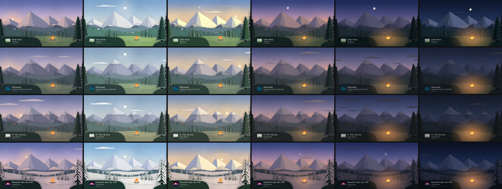
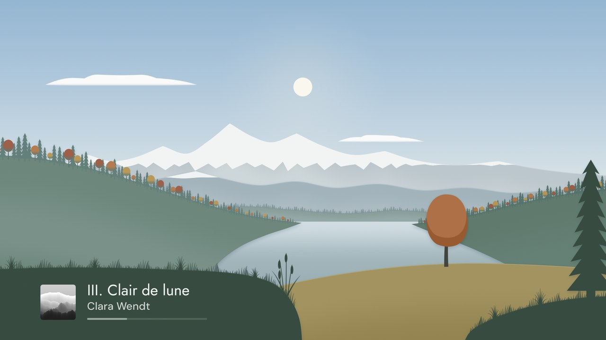
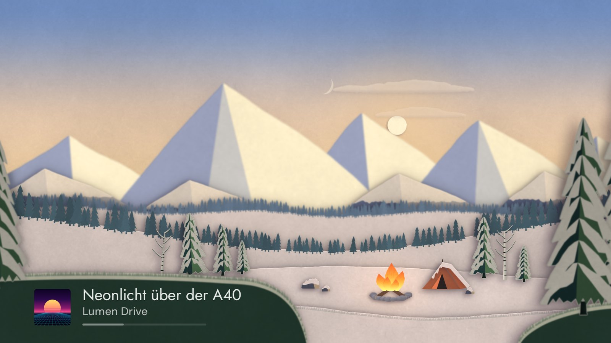
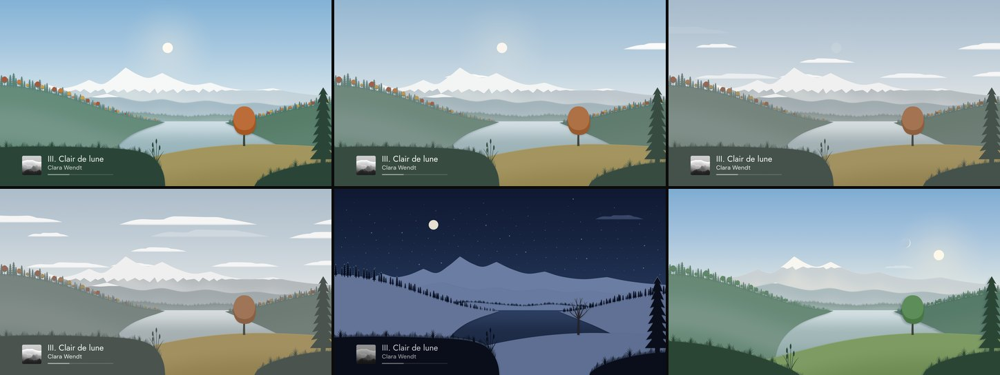
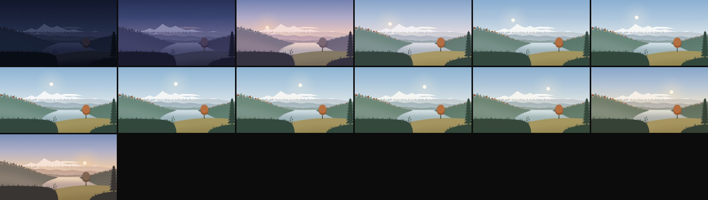
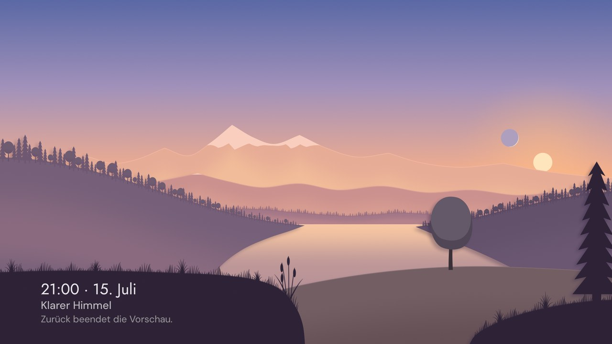
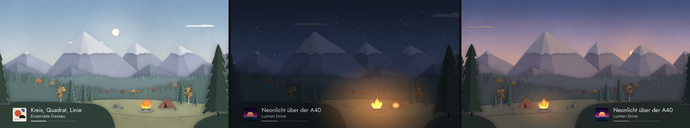

# Fensterblick

Ist die Musik angehalten (oder auf Wunsch auch während sie läuft), wird der Fernseher zu
einem Fenster auf ein Diorama aus Papier: gefaltete Berge mit Schneekappen aus gerissenem
Papier, gestaffelte Wälder, eine Lichtung mit einem Lagerfeuer aus Seidenpapier. Das Licht
folgt der echten Tageszeit, Sonne, Mond und Sterne stehen, wo sie gerade stehen, die Wolken
folgen dem Wetter, und über Wochen wechseln die Jahreszeiten. Unten links (oder rechts) liegt
klein, was gerade läuft.

*Ein Jahr in Berlin: Zeilen Frühling (26. April), Sommer (16. Juli), Herbst (10. Oktober),
Winter (22. Januar); Spalten Sonnenaufgang, Mittag, goldene Stunde, Dämmerung, blaue
Stunde, 23:30 Uhr.*

## Inhalt

1. [Kurs](#kurs)
2. [Recherche](#recherche)
3. [Richtungen und Entscheidung](#richtungen-und-entscheidung)
4. [Bildaufbau](#bildaufbau)
5. [Papier](#papier)
6. [Licht und Farbe](#licht-und-farbe)
7. [Himmel](#himmel)
8. [Jahreszeiten](#jahreszeiten)
9. [Bewegung](#bewegung)
10. [Einbindung in Klangbild](#einbindung-in-klangbild)
11. [Technik](#technik)
12. [Messung](#messung)
13. [Politur: Mängelliste](#politur-mängelliste)
14. [Bewusst weggelassen](#bewusst-weggelassen)
15. [Entscheidungen](#entscheidungen)

## Kurs

Drei Anläufe. Der erste ging in Richtung Farbholzschnitt mit möglichst echtem Himmel – das
Ergebnis wirkte wie eine misslungene Fotografie, „Comic-Wolken und ein seltsam echt wirkender
See“. Der zweite ersetzte das durch einen flachen Scherenschnitt aus glatten Flächen in
sorgfältig gemischten Farben; auch er las sich als Comic: „Organisch, wie echtes Papier,
keine super glatten Comic-Bilder. Außerdem eher Berge und Wald, gerne mit Lagerfeuer als
kleiner Akzent. So ähnlich wie Paper Mario.“

Der dritte Anlauf baut deshalb keine Flächen mehr, sondern ein Diorama aus echtem Papier:
Jeder Bogen hat seine Maserung, ist von Hand geschnitten, gefaltet und steht im Licht; jeder
wirft einen Schatten auf den Bogen dahinter. Der See ist verschwunden, die Lichtung mit dem
Lagerfeuer ist dazugekommen. Der Look wurde zuerst in Python-Studien gesucht (Textur, Kanten,
Falten, Schatten, Komposition, Tageszeiten und Jahreszeiten im Vergleich) und erst dann in die
App gebaut. Alles Weitere in diesem Dokument beschreibt diesen dritten Anlauf.

## Recherche

| Frage | Möglichkeiten | Ergebnis |
| --- | --- | --- |
| Womit zeichnen? | AGSL-Shader (ab API 33), OpenGL/Filament, Lottie/Rive, Vektorpfade pro Bild, vorgebackene Bitmaps | Vorgebackene Bitmaps, eingefärbt per Farbmatrix. Shader rechnen jedes Pixel in jedem Bild – auf der schwachen PowerVR-GPU bei 4K das teuerste Mittel; AGSL gibt es außerdem erst ab Android 13. Lottie und Rive brauchen Assets und laufen in Schleifen. Pfade pro Bild kosten CPU für die Tesselierung. |
| Wie wirkt Papier echt? | Papiertextur als Filter über dem fertigen Bild, Foto-Texturen, Textur je Bogen | Textur je Bogen, gerechnet: Pulpwolken, Wellung, Fasern, Zahn. Ein Filter über allem bricht nicht an den Schnittkanten ab und verrät sich sofort; Foto-Texturen wären Assets, die sich wiederholen. Ebenso wichtig wie die Textur: unregelmäßige Kanten, Falten im Licht, Schatten zwischen den Ebenen, leichte Tiefenunschärfe. |
| Wie sieht der Himmel aus? | Physikalische Modelle (Preetham, Hosek-Wilkie), gestaltete Farbtafeln | Gestaltete Farbtafeln je Tageszeit. Physik ergab trübe Mischtöne und genau den „echten“ Look, der nicht gewollt ist. |
| Sonne, Mond, Sterne | Nur `sun.sun` aus Home Assistant, eigene NOAA-Formeln, commons-suncalc | commons-suncalc 3.11 (Apache 2.0, reines Java, etwa eine Minute genau): Sonnen- und Mondstand, Mondphase. `sun.sun` kennt den Mond nicht. Sternzeit nach der Standardformel. |
| Wo steht der Fernseher? | Home Assistant `get_config`, Zeitzone | `get_config` (Breite, Länge); ohne Home Assistant die Hauptstadt der Zeitzone (Europa) oder Breite 50° und die Länge aus dem UTC-Versatz. |
| Bewegung ohne Schleife | Feste Animationen, Zufall, Rauschen | Summen aus Perlin-Rauschen mit inkommensurablen Perioden (Flammen, Feuerschein, Sterne); Wolkenfolge aus einem Hash ihrer Nummer. Nichts wiederholt sich erkennbar. |

## Richtungen und Entscheidung

Drei Richtungen, alle drei gebaut:

- **A – Farbholzschnitt, naturnah** (nach Hiroshi Yoshida, Kawase Hasui): Holzmaserung,
  modellierte Wolken, spiegelndes Wasser. Verworfen – beim Versuch, Natur nachzuahmen, landet
  man im Unheimlichen.
- **B – Flacher Scherenschnitt**: gestaffelte Bögen, jeder eine glatte Farbe, Licht als
  Verlauf zwischen ihnen. Verworfen – zu glatt, es wirkt wie eine Comic-Illustration.
- **C – Papier-Diorama** (in der Art von Paper Mario): Berge aus gefaltetem Karton, Wälder
  als Silhouettenstreifen, Aufsteller mit weißem Rand, Seidenpapier, echte Schatten zwischen
  den Ebenen. **Gewählt.**

**Begründung:** Ein Papier-Diorama verspricht keine Natur, sondern ein Ding – ein gebautes,
beleuchtetes Modell, das im Wohnzimmer steht und nicht so tut, als wäre es eine Landschaft.
Maserung, gefaltete Kanten und Schatten zwischen den Ebenen machen es greifbar, ohne ein
Detail zu zeigen, das man suchen müsste. Und die Technik passt zum Material: Jeder Bogen wird
einmal geschnitten und gemasert und danach nur noch eingefärbt – auf schwacher Hardware
billig.

## Bildaufbau

Von hinten nach vorn (Raster 960 × 540 dp, 18 dp Überstand für die Drift):

1. **Himmel** – eine Lavierung aus drei Farben auf Aquarellpapier.
2. **Sterne** (wie Löcher im Nachtpapier), **Mond** und **Sonne** – Papierscheiben mit einem
   weichen Schatten; Leuchten am Horizont und um die Sonne.
3. **Wolken** – Streifen aus gerissenem Seidenpapier, durchscheinend.
4. **Ferne Kette** – fünf gefaltete Berge, jeder ein eigenes Stück Karton mit Graten vom
   Gipfel zum Fuß (der höchste mit drei Flächen); Schneekappen aus gerissenem weißem Papier.
5. **Nahe Kette** – niedriger und bläulicher; im Winter mit eigenen Kappen.
6. **Ferner Wald** – ein Streifen kleiner Tannen, als eine Silhouette geschnitten.
7. **Naher Wald** – größere Tannen, zur Talmitte hin kleiner, dazwischen Laubbäume. Ihre
   Kronen liegen auf einem eigenen Bogen, den die Jahreszeit färbt.
8. **Wiese** der Lichtung.
9. **Aufsteller** – acht Tannen als Ausschnitte mit weißem Rand, in der Mitte gefaltet.
10. **Feuerholz** – ein Steinkreis, zwei Scheite mit hellen Schnittflächen.
11. **Flammen** – fünf Zungen aus zerknülltem Seidenpapier.
12. **Nahe Wiese** mit einer Franse aus kurzem Gras.
13. **Ufer vorn** – dunkel, mit Gras und den großen Tannen, die den Blick rahmen.

Der Mini-Player liegt auf dem dunklen Ufer, links oder rechts; das Feuer brennt immer auf der
anderen Seite der Lichtung. Steht der Mini-Player rechts, ist der ganze Vordergrund gespiegelt;
ist er aus, fällt das linke Ufer niedrig ab.

## Papier

- **Maserung** je Bogen: Pulpwolken von einem Fingerbreit bis zu einer Handbreite, eine
  langsame Wellung (das Papier liegt nicht ganz flach), kurze gebogene Fasern, heller oder
  dunkler als der Bogen, und ein feiner Zahn. Jeder Bogen liest sie mit eigenem Versatz:
  An jeder Schnittkante bricht sie ab wie bei zwei Stücken echten Papiers. Drei Papiere:
  Aquarellpapier (Himmel), weißes Papier (Schnee, Wolken, Sonne, Mond, Flammen), Karton.
- **Kanten:** von Hand geschnitten (leicht unregelmäßig), die Oberkante jedes Bogens fängt
  das Licht. Gerissen: Schneekappen, Wolken, Flammen.
- **Falten:** Berge falten sich an Graten vom Gipfel zum Fuß, Tannen in der Mitte. Die Seite
  zur Sonne (nachts zum Mond) ist hell, die andere liegt im Himmelslicht. Etwas Licht von
  rechts oben gibt es immer, damit die Falten auch mittags lesbar bleiben, wenn die Sonne
  vorn steht.
- **Tiefe:** Jeder Bogen wirft einen weichen Schatten auf den Bogen dahinter, weicher und
  weiter, je weiter er absteht; was dicht davor steht, verdunkelt ihn am Rand. Die fernen
  Bögen sind ein wenig unscharf, wie bei einem fotografierten Modell.
- **Aufsteller:** Die Tannen auf der Lichtung und am Ufer sind mit einem weißen Rand
  ausgeschnitten – das Zeichen eines Papiertheaters.
- **Schneekappen** sind eine Spur größer geschnitten als ihr Berg, wie ein aufgeklebtes
  Stück: Die Kante des Kartons scheint nirgends durch.

## Licht und Farbe

**Farbtafeln.** Für jede Tageszeit gibt es eine gestaltete Tafel – Nacht −16°, blaue Stunde
−7,5°, Dämmerung −3°, Sonnenauf- und -untergang 1°, goldene Stunde 6,5°, Vor- und
Nachmittag 18°, Tag 40°, morgens und abends eigene –, zwischen denen nach Sonnenhöhe
überblendet wird; um Mittag gehen Morgen- und Abendreihe ineinander über. Eine Tafel legt
fest: die drei Himmelsfarben, die Farbe des direkten Lichts und des Himmelslichts, wie hell
es ist, wie stark die Falten zeigen, wie viel Dunst, den Schatten, die Leuchten, die Sterne
und den Feuerschein.

Jeder Bogen ist ein Papier in der Farbe seiner Jahreszeit unter diesem Licht; ferne Bögen
nehmen etwas von der Horizontfarbe an (Luftperspektive). Weißes Papier (Ränder, Schnee) sinkt
nachts stärker ab als farbiges, damit im Dunkeln nichts leuchtet.

- **Feuer:** brennt immer. Bei Tag ist es ein kleiner Akzent, nachts das Licht der Lichtung:
  ein warmer Schein bis etwa 120 dp, der mit den Flammen atmet.
- **Mond:** echte Phase, die helle Seite zur Sonne. Nachts die ganze Scheibe, am Tag nur die
  blasse Sichel.
- **Wetter:** Bewölkung dämpft – Sättigung bis −65 %, die Werte rücken zusammen, Falten und
  Schatten werden weicher, ab dichter Bewölkung verschwinden Sonne und Mond. Nie dunkler, nur
  stiller. Regen, Schnee und Gewitter zählen nur als „bedeckt“.
- **Schatten** fallen vom Licht weg, länger bei tiefem Licht.
- **Kontrast:** Die Schrift des Mini-Players wird aus der Farbe des Ufers berechnet und hält
  auf seiner hellsten Maserung 4,5:1 (getestet über Tageszeit, Wetter, Mond und Jahreszeit).
  Unter dem Mini-Player bleibt das Ufer in jeder Jahreszeit dunkel; Schnee liegt nur als Band
  an seiner Kante.

## Himmel

- **Blick nach Süden:** Osten links, Westen rechts, 3 dp pro Grad Azimut – der ganze
  Sonnenbogen eines Tages passt ins Bild.
- **Höhen ab dem Bergkamm:** Die Höhe über dem Horizont wird vom geglätteten Kamm der fernen
  Kette aus gemessen, nach oben hin etwas enger. So geht die Sonne genau dann über dem Kamm
  auf, wenn das Licht morgendlich wird, und versinkt mit den Abendfarben dahinter – auch die
  tiefe Dezembersonne steht mittags über den Gipfeln.
- **Sterne:** 420 gleichmäßig verteilte Sterne in drei Helligkeiten, gedreht nach der
  Sternzeit; sie flackern in vier Gruppen langsam.
- **Wolken:** vier Bahnen in verschiedenen Höhen und Tempi, die unterste hinter den Gipfeln;
  fünf Formen aus Seidenpapier, Reihenfolge aus einem Hash – kein Muster wiederholt sich.
  Mehr Bewölkung heißt mehr Wolken; sie entstehen und vergehen langsam an Ort und Stelle.

## Jahreszeiten

Nach Kalender (auf der Südhalbkugel um ein halbes Jahr versetzt), jede Änderung über
Wochen:

| | Frühling | Sommer | Herbst | Winter |
| --- | --- | --- | --- | --- |
| Farben | frisches Grün | Grundtafel | Wiese strohgelb | kühler, ruhiger |
| Laubkronen | hellgrün, einige Wochen in Blüte | grün, kaum heller als die Tannen | Gold, Orange, Rost | verschwunden |
| Schnee auf den Bergen | weit herab | nur auf den höchsten Gipfeln | erste Kappen | alle Berge, auch die nahe Kette |
| Schnee am Boden | – | – | – | erst Flecken, dann alles weiß; Kappen auf allen Tannen |

Die Formen (Schnee, Laub) werden in Stufen von 1/16 neu geschnitten und über 20 Sekunden
überblendet; die Stufen liegen Tage auseinander. Die Blüte färbt nur, sie verlangt keinen
neuen Schnitt.

## Bewegung

Wenige, dauerhafte, langsame Bewegungen – keine Schleife, kein Sprung:

- **Licht** folgt der echten Uhrzeit (alle zehn Sekunden neu berechnet, jeder Schritt unter
  einer Farbstufe).
- **Wolken** ziehen von Westen nach Osten.
- **Feuer:** Die fünf Zungen strecken und neigen sich, jede nach ihrem eigenen Rauschen; der
  Schein atmet mit.
- **Sterne** flackern.
- **Drift:** Der ganze Bildschirm wandert wie überall in Klangbild um ±6 dp gegen Einbrennen.

20 Bilder pro Sekunde genügen dafür (die Vorschau zeichnet mit 30, weil dort das Licht
gleitet).

## Einbindung in Klangbild

**Wann er erscheint** (`VistaPolicy`):

- **Pause oder nichts spielt:** nach der Zeit unter *Fensterblick → Bei Pause*
  (Standard drei Minuten; 5 s bis 10 min oder aus). Bis dahin zeigt die Bühne das pausierte
  Cover bzw. die Ruhe-Uhr. Ist der Fensterblick aus, wird ein pausiertes Cover wie bisher
  nach drei Minuten zur Uhr.
- **Während der Musik:** nur wenn unter *Während der Musik* eine Zeit gewählt ist
  (1–30 Minuten ohne Tastendruck).
- **Nie über Bildschirmen, die etwas zu sagen haben:** Verbindung weg, Home Assistant nicht
  erreichbar, Lautsprecher unbekannt, Einrichtung. Und nicht, solange das Menü offen ist.
- **Ausschalten:** „Ausschalten nach“ gilt weiter – ohne Musik gibt Klangbild den
  Bildschirm nach der eingestellten Zeit frei, auch wenn der Fensterblick läuft.
- **Vorausgebacken:** Ist der Fensterblick eingeschaltet, wird sein Bild schon im
  Hintergrund gebacken (ein Thread niedriger Priorität), damit er sofort erscheinen kann.

**Fernbedienung:**

- Jede Taste beendet den Fensterblick weich (Blende durch das Dunkle) und startet die
  Wartezeit neu; die Taste selbst bewirkt sonst nichts. Medientasten tun zusätzlich, was sie
  sagen. Zurück beendet ihn, statt die App zu schließen.
- **Pfeil runter lange drücken** zeigt ihn sofort (nicht, wenn hoch/runter die Lautstärke
  regeln – dort bleibt das gehaltene Runter die Lautstärke).
- Aus Home Assistant per `am start`: `--es fensterblick an|aus|zeitraffer`, außerdem
  `fensterblick_pause`, `fensterblick_musik` (Sekunden oder „aus“), `mini_player`
  (`links|rechts|aus`) und `weather` (Entität, `auto` oder `keine`). Ein
  `klangbild://`-Link darf dasselbe – nur nicht die Wetter-Entität.

**Menü → Fensterblick:** Bei Pause, Während der Musik, Mini-Player (Unten links / Unten
rechts / Aus), Vorschau.

**Vorschau:** OK auf *Vorschau* zeigt den Fensterblick. Links/rechts verstellen die Stunde,
hoch/runter den Monat, OK das Wetter (wie draußen, klar, leicht bewölkt, bedeckt), OK lange
(oder die Play-Taste) lässt einen Tag in zwei Minuten vergehen, Zurück führt ins Menü.
Statt des Mini-Players steht dort, was gezeigt wird.

**Mini-Player:** Cover (56 dp), Titel in Jost 24 sp, Künstler in DM Sans 17 sp, ein schmaler
Fortschrittsbalken (pausiert gedimmt); nachts wird das Cover mit dem Bild dunkler.

**Einrichtung am Handy:** Abschnitt *Fensterblick* mit der Wetter-Entität: *Automatisch*
(`weather.forecast_home` oder `weather.home`, wie sie die Met.no-Integration anlegt), eine
gefundene Entität oder *Keines* (immer ein heiterer Himmel). Den Standort liefert Home
Assistant selbst.

## Technik

- **Gebacken, nicht gezeichnet:** Jeder Bogen wird einmal pro Bildschirmgröße und
  Jahreszeit-Form geschnitten (exaktes Anti-Aliasing). Gespeichert werden keine Farben,
  sondern die Gewichte zweier Tinten (Rot, Grün), das Licht des Papiers selbst – Maserung,
  Verdeckung, Lichtkante – (Blau) und die Deckung (Alpha). Pro Bild färbt eine Farbmatrix
  jeden Bogen ein: Das Licht ändert sich, ohne dass etwas neu geschnitten wird.
- **Zwei Ebenen bleiben stehen:** Himmel (mit Sonne und Mond) und Land werden nur neu
  gezeichnet, wenn das Licht weitergerückt ist (alle zehn Sekunden); Sterne, Wolken und Feuer
  darüber in jedem Bild. Pro Bild sind das etwa 2,3 Bildschirmflächen statt 5,3.
- **Nur was zu sehen ist:** Jeder Bogen hat seine eigene Box und reicht nur so weit nach
  unten, wie ihn nichts verdeckt.
- **Backen** (JVM, Desktop): 1,25 s bei 1080p, 5,4 s bei 4K. **Speicher:** 30 MB Bitmaps bei
  1080p, 120 MB bei 4K, dazu die zwei stehenden Ebenen (je eine Bildschirmfläche); die
  gebackenen Pixel selbst werden freigegeben, sobald die Bitmaps stehen.
- **Pro Bild auf der CPU:** Wolkenplätze und Flammen (wenige Mikrosekunden); alle zehn
  Sekunden Sonne/Mond, Farben, Sterne.
- Code: `vista/` (Motiv, Papier, Backen, Licht, Himmel, Welt, Uhr, Wolken), `ui/vista/`
  (Zeichnen, Bildschirm, Mini-Player), `domain/VistaPolicy`.

## Messung

Ein Gerät stand nicht zur Verfügung. Gemessen wurde

- **auf der JVM** (Robolectric/Desktop): Backzeit und Speicher (siehe Technik);
- **im Android-TV-Emulator der CI** (Android 14, Software-GPU SwiftShader, CI-Lauf
  38022314275): 15 Minuten ruhig, dann 2 Minuten Zeitraffer, je im 1080p- und im 4K-Profil.

| Profil | ruhig: Bilder/s | CPU (ein Kern) | Speicher (PSS) | Zeitraffer: Bilder/s | CPU | Speicher |
| --- | --- | --- | --- | --- | --- | --- |
| 1080p | 8 | 36 % | 105–114 MB, kein Wachstum | 4 | 52 % | 108–116 MB |
| 4K (zeichnet in 1080p) | 6 | 37 % | 108–115 MB, kein Wachstum | 5 | 40 % | 110–117 MB |

Kein Absturz (Logcat), der Bildschirm nach 15 Minuten zeigt das Bild wie die Tests – mit
echtem Android-Rendering, also auch die stehenden Ebenen, die Farbmatrizen und den
Feuerschein. Zum Vergleich der Mess-Prototyp des zweiten Anlaufs: 3–5 Bilder/s, 21–26 % CPU,
63–88 MB. Mehr Bilder trotz reicherem Bild, weil pro Bild nur noch die zwei stehenden Ebenen,
die Wolken und das Feuer gezeichnet werden; mehr Speicher, weil das Diorama mehr Bögen hat
und die Ebenen je eine Bildschirmfläche belegen (gemessen vor dem Freigeben der gebackenen
Pixel, das den Java-Speicher um weitere 30 MB senkt). Das 4K-Profil des Emulators zeichnet die
Oberfläche in 1080p (`wm size`: 3840 × 2160, Override 1920 × 1080).

Die Bildrate des Emulators sagt wenig über den Google TV Streamer: SwiftShader rechnet alles
auf der CPU. Aussagekräftig sind Speicher (wächst er?) und dass nichts abstürzt.
**Nicht am Gerät geprüft:** Bildrate und GPU-Last auf dem Streamer, ob die App dort in 1080p
oder 4K zeichnet, ob die stehenden Ebenen dort wirklich zwischen den Bildern stehen bleiben,
Backzeit auf dem Gerät, Einbrennverhalten auf dem OLED.

## Politur: Mängelliste

Nach dem Durchsehen aller Tages- und Jahreszeiten (Galerie oben), der Bildfolgen und von
Ausschnitten in 4K:

| # | Mangel | Behoben durch |
| --- | --- | --- |
| 1 | Gefaltete Berge wie Kisten (senkrechte Falten) | jeder Berg ein eigenes Stück mit Graten vom Gipfel zum Fuß |
| 2 | Körnung wie Filz, „Rauschen“ | Pulpwolken und Fasern statt Pixelrauschen, kaum Zahn |
| 3 | Fasern in 4K wie Kratzer | kürzer, gebogen, schwächer |
| 4 | Feuer wie ein Emoji | zerknülltes Seidenpapier, gerissene Ränder, durchscheinend, Schein |
| 5 | Fäden an den Flammenspitzen | Ränder nur so zerrissen, wie die Zunge breit ist |
| 6 | Wald wie ein Zaun gleicher Bäumchen | Silhouettenstreifen, Bäume verschieden hoch und in Gruppen |
| 7 | Weiße Ränder leuchten nachts wie Neon | weißes Papier sinkt nachts stärker ab |
| 8 | Mond am Tag wie eine zweite Sonne | am Tag nur die blasse Sichel |
| 9 | Kahle Laubbäume als Pfähle im Schnee | ohne Laub verschwinden sie |
| 10 | Büsche wie Brötchen | entfernt |
| 11 | Wolkenstreifen hinter einem Sattel wie ein Kratzer | die Wolkenbahnen liegen höher |
| 12 | Frühling: Laubkronen wie Popcorn | Blüte nur in ihren Wochen, sonst frisches Grün |
| 13 | Schneezungen wie Zuckerguss | ein breites, flaches V entlang der Falte |
| 14 | Dunkler Saum unter den Schneekappen | Kappe eine Spur größer als ihr Berg, kein Schatten auf den Himmel |
| 15 | Mittags flache Berge | etwas Licht von rechts oben immer, mehr Faltkontrast am Mittag |
| 16 | Ufer zu hell für 4,5:1 in drei Stufen | dunkleres Ufer, Kontrast auf der hellsten Maserung gerechnet |
| 17 | Schnee unter dem Mini-Player | Schnee nur als Band an der Uferkante |
| 18 | Nacht zu dunkel | mehr Mond- und Himmelslicht |
| 19 | Vordergrund zu unscharf | Tiefenunschärfe vorn halbiert |
| 20 | Nahe Kette im Abendlicht khakifarben | bläulicheres Papier |
| 21 | Einige Sekunden Dunkel, bevor das Bild erscheint (Backen) | Bild wird vorausgebacken |

## Bewusst weggelassen

- Regen, Schnee, Blitze, Nebel, Partikel – das Wetter ist nur Stimmung. Auch kein Rauch und
  keine Funken über dem Feuer.
- Wind, Temperatur, Luftfeuchte.
- Ein Ereigniskatalog – und auch der eine erlaubte seltene Moment: Jede Figur, die durchs
  Bild zieht, holt den Blick von der Musik weg und wäre irgendwann die bekannte Figur.
- Der See, Zelt, Tiere, Häuser, Menschen. Das Feuer erzählt genug.
- Wiegendes Gras und Kronen: Das Land ist eine stehende Ebene (billig zu zeichnen); bewegt
  sind Himmel und Feuer.
- Ebenen-Parallaxe: Die Drift verschiebt alles gemeinsam; einzeln verschobene Ebenen würden
  die Linien der Komposition gegeneinander laufen lassen.

## Entscheidungen

- **Papier-Diorama statt Holzschnitt und statt flachem Scherenschnitt** – siehe Kurs und
  Begründung oben.
- **Berge und Wald, ein Lagerfeuer als Akzent**, kein See.
- **Gestaltete Farbtafeln statt Himmelsphysik**, Morgen und Abend getrennt, um Mittag
  überblendet; Papierfarben je Jahreszeit unter diesem Licht.
- **Höhen ab dem Bergkamm**: Sonnenauf- und -untergang am Kamm, wenn die Farben wechseln.
- **Die Komposition folgt dem Mini-Player** (der Vordergrund gespiegelt, das Feuer gegenüber).
- **Das Feuer brennt immer** – bei Tag als Akzent, nachts als Licht der Lichtung.
- **Pause → Fensterblick nach drei Minuten** – dieselbe Zeit, nach der bisher die Uhr kam.
  Die Uhr bleibt für die ersten Minuten ohne Musik und für den ausgeschalteten Fensterblick.
- **Während der Musik standardmäßig aus:** Das Cover ist dann das Bild.
- **Pfeil runter lange** als Taste: Die Fernbedienung des Streamers hat keine freie Taste,
  Pfeil runter zeigt sonst nur Informationen. Mit Lautstärke auf hoch/runter entfällt sie.
- **OK lange startet in der Vorschau den Zeitraffer**, weil der Streamer keine Play-Taste
  hat; die Play-Taste anderer Fernbedienungen tut dasselbe.
- **Wetter automatisch:** die Entitäten, die Home Assistants Standard-Wetter anlegt; sonst
  auf der Einrichtungsseite wählen.
- **Standort aus Home Assistant**, ohne ihn aus der Zeitzone geschätzt.
- **20 Bilder pro Sekunde**, Vorschau 30.
- **Jahreszeiten nach Kalender**, auf der Südhalbkugel versetzt.
